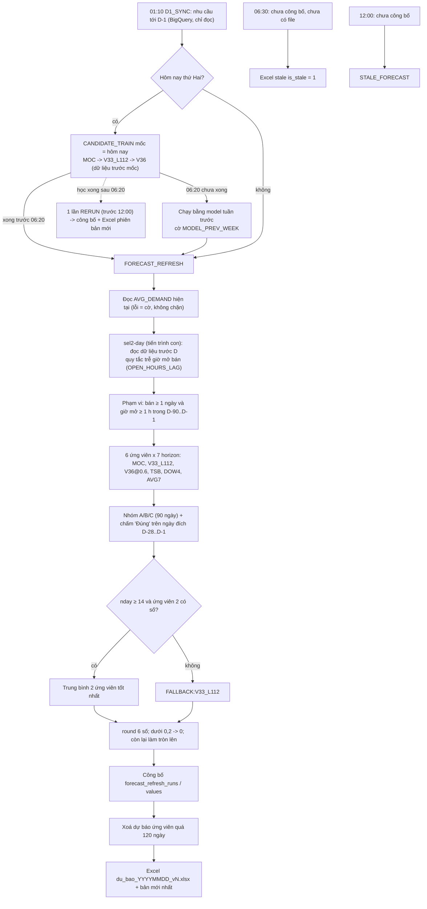
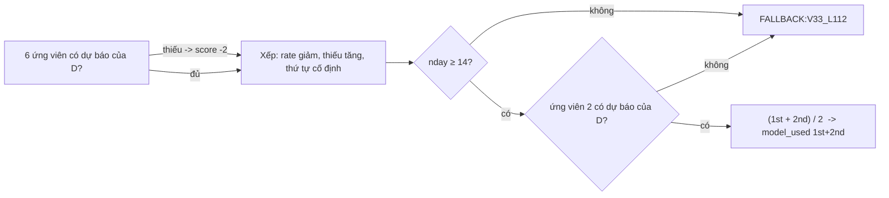

# 03 – Logic dự báo hằng ngày (luồng SEL2, bản 1.4.2)

Tài liệu cho kỹ sư mới: đủ chi tiết để dựng lại toàn bộ logic từ dữ liệu tới con số trong file Excel. Mọi quy tắc có
tham chiếu code dạng `đường_dẫn:dòng` (tương đối từ gốc mã nguồn, bản 1.4.2 – commit `51b0ede`). Khi tài liệu này và
code khác nhau thì **code thắng**. Mọi mã SKU / FC / khách trong ví dụ là **mã giả**.

Đường dẫn code dùng trong tài liệu (đều dưới `backend/app/`):

| Viết tắt | File |
|---|---|
| `scope.py`, `data.py`, `simple.py`, `extras.py`, `lgbm.py`, `select.py`, `pipeline.py`, `store.py`, `jobs.py`, `export.py`, `avg_demand.py`, `errors.py`, `source_config.py` | `backend/app/ml/sel2/<file>` |
| `features.py`, `model.py`, `sku_group.py`, `accuracy_report.py`, `daily_refresh.py` | `backend/app/ml/<file>` |
| `scheduler.py` | `backend/app/jobs/scheduler.py` |
| `settings_service.py` | `backend/app/settings_service.py` |

---

## 1. Tóm tắt một trang

| Bước | Nội dung | Code |
|---|---|---|
| Dữ liệu vào | Nhu cầu ngày theo SKU × FC (`demand_daily`, nguồn BigQuery `demand_planing_lightgbm`), giờ mở bán (`open_hours_daily`), giá, số khách; cửa sổ dữ liệu từ `data_policy.window_start_date` (production: 2026-01-01) tới D-1 | `data.py:111-201` |
| Phạm vi ngày D | SKU × FC có ≥ 1 ngày bán **và** tổng giờ mở bán ≥ 1,0 giờ trong D-90 .. D-1 | `backend/app/ml/sel2/scope.py:14-31` |
| Nhóm A/B/C | Quy tắc B7 trên 90 ngày D-90 .. D-1 (chỉ ngày mở bán) – chỉ dùng cho tiêu chí "Đúng" | `data.py:87-104`, `sku_group.py:31-58` |
| 6 ứng viên | `MOC`, `V33_L112`, `V36_two_stage@0.6` (LightGBM, học lại thứ Hai) + `TSB`, `DOW4`, `AVG7` (công thức) | `select.py:27`, `lgbm.py:61-65`, `simple.py` |
| Chọn (SEL2) | Mỗi SKU × FC: xếp 6 ứng viên theo tỷ lệ "Đúng" trên các ngày đích D-28 .. D-1, hoà → thiếu hàng ít hơn; lấy **trung bình 2 ứng viên đầu**; < 14 ngày đánh giá → `FALLBACK:V33_L112` | `select.py:150-212` |
| Làm tròn | Làm tròn 6 chữ số thập phân; < 0,2 → 0; còn lại làm tròn **lên** | `daily_refresh.py:61-68`, `select.py:31` |
| Công bố | 1 bản ghi `forecast_refresh_runs` + 7 dòng / SKU × FC trong `forecast_refresh_values` (`config_version` = `SEL2:<hash>`) | `store.py:308-337` |
| Excel | `forecast_used` theo **quy tắc cố định 05/11/2026** (mục 10): số LightGBM của hôm nay khi cấu hình `LIGHTGBM` (kể cả 0); ngoài phạm vi lần chạy tham chiếu → **0** (mọi tiền tố mã); thiếu số / hôm nay lỗi → số của lần chạy thành công gần nhất trong 3 ngày (`DUNG_SO_LAN_CHAY_TRUOC`); không có → AVG_DEMAND; `AVG_DEMAND` không có Avg → số LightGBM; luôn làm tròn (< 0,2 → 0, còn lại lên), không bao giờ trống | `export.py:367-430` |

Kết quả kiểm chứng (backtest ngày dự báo 01/06–22/10/2026, chỉ số chính "% SKU × ngày Đúng", 7 ngày): SEL2 **69,8 %**,
mô hình mốc (MOC) **64,6 %**, Avg Demand cũ **36,5 %** (ngày 1, cùng tập ô) – [01_tong_quan.md](01_tong_quan.md) mục 3.1. Tái lập trên bản sao DB ngày 15/07 và 15/10 bằng code 1.4.0 (phần
tính SEL2 không đổi ở 1.4.1 / 1.4.2): sai khác lớn nhất **0,0**, `model_used` trùng 100 %. Chi tiết: mục 15.

---

## 2. Thuật ngữ và quy ước

| Thuật ngữ | Nghĩa |
|---|---|
| D (ngày dự báo, `forecast_date`) | Ngày lịch Việt Nam (Asia/Ho_Chi_Minh) mà lần chạy phục vụ. Chỉ đọc dữ liệu **< D** (tới D-1). |
| horizon h | 1..7. Ngày đích (`target_date`) = D + h − 1 (h = 1 là chính ngày D). |
| Chuỗi / series | Một cặp (SKU, FC) = `(sku_code, fc_code)` (trong bảng nhu cầu là `sku_id`, `fc_id`). |
| Mốc huấn luyện (origin) | Thứ Hai gần nhất ≤ D (`retrain_weekday` = 1): `origin_of(d) = d − ((isoweekday(d) − 1) mod 7)` – `pipeline.py:80-82`. Model của mốc học trên dữ liệu < mốc. |
| Ô (cell) | Một (SKU × FC, ngày dự báo, horizon) có ngày đích đã biết thực bán. |
| Ngày mở bán | Ngày có giờ mở bán > 0 (`open_hours_daily.total_open_hours`, sau quy tắc trễ giờ mở bán, mục 3.2). Không có dòng = đóng. |
| DAY0 | 2025-01-01: chỉ số ngày của mọi mảng K × G trong `data.py` (`data.py:30`). |
| Thực bán (actual) | `demand_daily.qty` của đúng ngày; không có dòng = 0 (không có đơn). |

---

## 3. Dữ liệu đầu vào của một ngày (`data.load_inputs`)

### 3.1 Đọc

`data.py:111-201`, chỉ đọc, từ một kết nối SQLite:

| Thành phần | Nguồn | Ghi chú |
|---|---|---|
| Khung nhu cầu | `lgbm.load_frame` → `data.demand.load_demand(scope_key, start=window_start, end=D-1)` + giờ mở bán ghi đè đã duyệt (`open_hours_override`) | `lgbm.py:73-83`. Sắp xếp ổn định theo (ngày, sku_id, fc_id). Cột dùng: `qty`, `avg_unit_price`, `open_hours`, `customer_count`, `repeat_customer_count`, `repeat_interval_days_sum` (+ `avg_discount_rate`, `promo_share` nếu có). |
| Lịch giờ mở bán | `open_hours_daily` lọc `source_table` + `seller_code` của cấu hình `daily_forecast` (bảng BigQuery `lakehouse-prod-394907.gold_buymed_vn2.openhours_by_sku`) | `data.py:131-145` (đọc tuần tự `NOT INDEXED`, theo lô 200.000 dòng) |
| Mảng K × G | `daily` (float64, 0 = không có đơn), `has_row` (bool), `oh` (float32, NaN = không có dòng) | `data.py:122-129`, `data.py:133` |

Số khách (`customer_*`) được tính từ dữ liệu **mức dòng đơn** (customer_id, mã đơn, ngày đặt, số lượng): số khách
phân biệt trong ngày, số khách mua lặp lại và tổng số ngày kể từ lần mua trước của các khách lặp lại (module
`backend/app/data/customers.py`). Mô hình chỉ thấy các tổng ngày này, theo từng SKU × FC.

### 3.2 Quy tắc trễ giờ mở bán (`open_hours_lag_days` = L = 2)

Nguồn giờ mở bán của BI thường chỉ tới D-2. Quy tắc (`data.py:9-15`, `data.py:146-197`):

1. Ngày cuối của nguồn (`last`) cách D-1 hơn L ngày → lỗi `OPEN_HOURS_INVALID` (`data.py:151-152`).
2. Các ngày lịch sau `last` (tối đa L ngày, tới D-1) được chép giờ mở bán của ngày `last` (cùng SKU × FC)
   (`data.py:153-156`).
3. Dòng nhu cầu thiếu giờ mở bán (`open_hours_status = MISSING`) trong L ngày cuối được lấy giá trị đã biết gần nhất
   trong L ngày trước nó (dòng nhu cầu, rồi tới lịch nguồn); không có, trạng thái khác `MISSING`, hoặc dòng thiếu giờ
   nằm trước D-L → `OPEN_HOURS_INVALID` (`data.py:158-196`).
4. Có bất kỳ ô nào được điền → cờ `OPEN_HOURS_LAG` cho cả lần chạy (`data.py:197-200`).

`OPEN_HOURS_INVALID` khi chạy theo lịch là trạng thái `NOT_READY` (lịch thử lại sau), không phải lỗi hỏng
(`jobs.py:48`, `jobs.py:321-322`).

---

## 4. Phạm vi (scope) của ngày D

`scope.py:14-31`:

```
in_scope(k, D) = (số ngày trong D-90 .. D-1 có daily > 0) >= 1
                 AND (tổng clip(giờ mở bán, 0) trong D-90 .. D-1, NaN = 0) >= 1,0 giờ
```

* `SCOPE_DAYS = 90`, `MIN_OPEN_HOURS = 1.0` (`scope.py:14-15`). Mảng phải phủ đủ 90 ngày, nếu không →
  `SEL2_WINDOW_NOT_COVERED` (`scope.py:21-22`).
* Tổng giờ tính bằng tổng cộng dồn float32 từ DAY0, hiệu hai tổng lấy float64 – y hệt backtest (`scope.py:25-30`).
* Phạm vi áp cho **cả học và dự báo**: model của mốc c học các chuỗi trong phạm vi của c (`pipeline.py:194`); ngày D
  chỉ dự báo các chuỗi trong phạm vi của D (`pipeline.py:221-224`).
* Lưu ý: tài liệu nghiệp vụ ghi "≥ 1 ngày có giờ mở bán"; code thực tế là **tổng giờ mở bán ≥ 1,0 giờ**.

---

## 5. Nhóm A / B / C (`sku_group.py`, chế độ `ROLLING_B7`)

Tính lại **mỗi ngày D** cho mọi chuỗi, trên 90 ngày lịch D-90 .. D-1 (`data.py:87-104`, `sku_group.py:31`). Chỉ đếm
**ngày mở bán** (giờ mở bán > 0); ngày mở bán không có dòng nhu cầu = 0 nhu cầu (`sku_group.py:74-81`).

| Đại lượng | Công thức |
|---|---|
| `n_open_days` | số ngày mở bán trong cửa sổ |
| `avg_per_open_day` | tổng nhu cầu / `n_open_days` |
| `zero_share` | số ngày mở bán có nhu cầu 0 / `n_open_days` |

| Nhóm | Điều kiện (`sku_group.py:50-58`) |
|---|---|
| A (bán nhanh) | `n_open_days` ≥ 14 **và** avg > 20 **và** zero_share ≤ 0,20 |
| C (bán chậm) | `n_open_days` ≥ 14 **và** avg ≤ 5 **và** zero_share > 0,20 |
| B | còn lại (kể cả < 14 ngày mở bán); chuỗi không có nhóm cũng coi là B (`accuracy_report.py:72-75`) |

Nhóm **không** chọn công thức dự báo; nó chỉ quyết định dung sai của tiêu chí "Đúng" (mục 8.2) và cột `nhom` của
Excel. Chế độ `FIXED` (cửa sổ cố định) chỉ dùng để tái lập backtest (`settings_service.py:703-705`).

---

## 6. Sáu mô hình ứng viên

Danh sách và thứ tự cố định: `("MOC", "V33_L112", "V36_two_stage@0.6", "TSB", "DOW4", "AVG7")` (`select.py:27`).
Thứ tự này còn là tiêu chí hoà cuối cùng (mục 8.4). Mọi giá trị ứng viên là float64, cắt ở 0, **chưa làm tròn**.

### 6.1 Phần chung của 3 ứng viên LightGBM

**Cấu hình ghim** (`lgbm.py:50-59`, không đọc cấu hình `model` đang lưu của app): DIRECT, `feature_sku_code = False`,
trọng số horizon 3,0 khi h ≤ 7, `max_train_days` 730, bước mốc 7 ngày, `backtest_horizon_days` 30. Mỗi lần học, nhóm
biến được phân giải theo độ phủ dữ liệu trước mốc (`registry.resolve`, ngưỡng `feature_min_coverage` 0,5), rồi bật giờ
mở bán và thứ ISO (`lgbm.py:127-139`). Với dữ liệu production 11/2026: giá và khách hàng **bật**; chiết khấu
(`disc_last`) và khuyến mãi (`promo_last`, `promo_mean_7`) **không có** trong model đã học. Nếu dấu vân tay cấu hình
khác bản backtest (`8468ebe66d1706f7`) thì model vẫn dùng, chỉ gắn cờ `CONFIG_DRIFT` (`lgbm.py:117-118`,
`lgbm.py:313-315`).

**Tham số LightGBM** (`model.py:43-56` gọi không kèm `names` → không có `feature_contri`; `lgbm.py:294`):

| Tham số | Giá trị |
|---|---|
| `objective` | `tweedie` (`tweedie_variance_power` 1,2); tầng phân loại của V36: `binary` |
| `num_boost_round` | 300 |
| `learning_rate` | 0,05 |
| `num_leaves` | 31 |
| `min_data_in_leaf` | 20 |
| `feature_fraction` / `bagging_fraction` / `bagging_freq` | 0,9 / 0,9 / 1 |
| `lambda_l2` | 1,0 |
| `seed` | 7 (cũng quyết định mẫu dòng dựng bin – `SeqDataset`, `lgbm.py:260-276`) |
| `deterministic` / `force_row_wise` | True / True |
| `num_threads` | 0 = không đặt (mặc định OpenMP). **Không đổi**: đổi số luồng làm model khác. |
| Biến phân loại | `fc_code` (`lgbm.py:305`) |

**Dòng huấn luyện** (`lgbm.py:184-195`, `lgbm.py:280-330`):

* Panel: các chuỗi trong phạm vi của mốc, dữ liệu < mốc, tối đa 730 ngày (thực tế từ 2026-01-01). Trong panel, ngày
  chưa bắt đầu bán và ngày lịch không có đơn nào của cả phạm vi là NaN (không phải 0) (`features.py:120-124`).
* Mốc con t0 = T − 7·j, j = 1..n_origins (MOC 12, V33/V36 16), bỏ t0 < 7.
* Với mỗi t0, horizon h = 1..30 (`direct_max_horizon` = `backtest_horizon_days` 30, `lgbm.py:292`,
  `model.py:59-61`) sao cho ngày đích t0 + h − 1 < T; một dòng = một chuỗi đã bắt đầu trước t0 và có nhãn đã biết.
* Biến mốc tính từ cột < t0; biến lịch tính theo **ngày đích**; cột cuối `horizon` = h.
* Trọng số dòng = 3,0 khi h ≤ 7, ngược lại 1,0 (`lgbm.py:303`).
* Học theo khối (`BlockSeq`, `lgbm.Sequence`) để không giữ cả ma trận float32 trong RAM; model giống hệt cách dựng ma
  trận đầy đủ (`lgbm.py:199-257`).

**Dự báo ngày D** (`lgbm.py:333-368`): panel = chuỗi trong phạm vi D, dữ liệu < D; biến mốc tại t0 = T (tức dùng tới
D-1); 7 horizon, ngày đích D..D+6; mã `fc_code` lấy từ panel huấn luyện; giá trị `max(dự báo, 0)`.

### 6.2 MOC – 35 biến (đọc từ file model mốc 2026-11-02)

Nguồn công thức: `features.py:260-335` (biến mốc), `features.py:350-363` (lịch + horizon). "Cửa sổ w" = w cột ngày
ngay trước mốc; "đã biết" = không NaN.

| # | Biến | Ý nghĩa | Công thức / cửa sổ | Nguồn cột |
|---:|---|---|---|---|
| 1 | `fc_code` | Kho (phân loại) | chỉ số của FC trong danh sách FC đã sắp của panel huấn luyện; FC mới = −1 | `fc_id` |
| 2 | `series_age` | Tuổi chuỗi | t0 − ngày bán đầu tiên trong panel (ngày) | `qty` |
| 3–9 | `lag_1` .. `lag_7` | Nhu cầu k ngày trước | Y[t0 − k] (NaN nếu chưa bán / ngày trống toàn phạm vi) | `qty` |
| 10–12 | `lag_14`, `lag_21`, `lag_28` | Nhu cầu cùng thứ các tuần trước | Y[t0 − k] | `qty` |
| 13–16 | `roll_mean_7/14/28/56` | Trung bình trượt | trung bình các giá trị đã biết trong cửa sổ w | `qty` |
| 17 | `roll_std_7` | Độ lệch chuẩn 7 ngày | std quần thể (ddof 0) các giá trị đã biết; < 2 giá trị → NaN | `qty` |
| 18 | `roll_std_28` | Độ lệch chuẩn 28 ngày | như trên, cửa sổ 28 | `qty` |
| 19 | `zero_share_28` | Tỷ lệ ngày 0 | số ngày = 0 / số ngày đã biết, cửa sổ 28 | `qty` |
| 20 | `days_since_last_sale` | Số ngày từ lần bán gần nhất | trong 180 ngày: số ngày từ ngày cuối có qty > 0,5; không có → 181 | `qty` |
| 21 | `roll_max_28` | Đỉnh 28 ngày | max các giá trị đã biết | `qty` |
| 22 | `price_last` | Giá gần nhất | giá đơn vị bình quân ngày t0 − 1, điền tiến (forward-fill) | `avg_unit_price` |
| 23 | `price_rel_28` | Giá tương đối | `price_last` / trung bình giá (đã điền tiến) 28 ngày; mẫu ≤ 0 → NaN | `avg_unit_price` |
| 24 | `open_hours_last` | Giờ mở bán hôm trước | giờ mở bán ngày t0 − 1; không biết → NaN (không bao giờ 0) | `open_hours` (sau quy tắc trễ) |
| 25 | `open_hours_mean_7` | Giờ mở bán TB 7 ngày | trung bình giá trị đã biết 7 ngày | `open_hours` |
| 26 | `cust_mean_28` | Số khách TB/ngày | trung bình số khách phân biệt các ngày đã biết trong 28 ngày | `customer_count` |
| 27 | `cust_repeat_share_28` | Tỷ lệ khách lặp lại | Σ khách lặp lại / Σ khách (ngày cả hai đã biết), 28 ngày | `repeat_customer_count`, `customer_count` |
| 28 | `cust_repeat_interval_28` | Chu kỳ mua lại TB | Σ ngày kể từ lần mua trước / Σ khách lặp lại, 28 ngày | `repeat_interval_days_sum`, `repeat_customer_count` |
| 29 | `dow` | Thứ của ngày đích | ISO 1 = thứ Hai .. 7 = Chủ nhật | lịch |
| 30 | `dom` | Ngày trong tháng | 1..31 | lịch |
| 31 | `month` | Tháng | 1..12 | lịch |
| 32 | `weekofyear` | Tuần ISO | 1..53 | lịch |
| 33 | `is_weekend` | Cuối tuần | 1 nếu thứ Bảy / Chủ nhật | lịch |
| 34 | `days_to_month_end` | Số ngày tới cuối tháng | số ngày của tháng − ngày | lịch |
| 35 | `horizon` | Horizon | h (1..7 khi dự báo; 1..30 khi học) | – |

`sku_code` bị bỏ (`features.py:194-200`, `feature_sku_code = False`). Thứ tự cột: biến mốc (1–28) rồi lịch ngày đích
và `horizon` (29–35) (`features.py:225-233`).

### 6.3 V33_L112 – 54 biến = MOC + 19 biến, 16 mốc (112 ngày)

Thứ tự cột: 28 biến mốc của MOC → 14 biến ROBUST → 5 biến DAYPROF → 7 biến lịch + `horizon` (`lgbm.py:143-152`).
Công thức: `extras.py:23-113`. Y = panel nhu cầu (NaN = chưa bán / ngày trống).

| Biến | Ý nghĩa | Công thức / cửa sổ | Nguồn |
|---|---|---|---|
| `med_7`, `p25_7`, `p75_7` | Trung vị, phân vị 25 %, 75 % | `nanpercentile` (nội suy tuyến tính) của giá trị đã biết trong 7 cột trước mốc | `qty` |
| `med_14`, `p25_14`, `p75_14` | như trên | 14 cột | `qty` |
| `med_28`, `p25_28`, `p75_28` | như trên | 28 cột | `qty` |
| `med_56`, `p25_56`, `p75_56` | như trên | 56 cột | `qty` |
| `tmean_28`, `tmean_56` | Trung bình cắt đỉnh | bỏ ceil(0,10 × n) giá trị **lớn nhất** trong n giá trị đã biết, lấy trung bình phần còn lại (`extras.py:35-49`) | `qty` |
| `dow_share_8w` | Tỷ trọng thứ của ngày đích | Σ nhu cầu các ngày cùng thứ / Σ nhu cầu, 56 cột trước mốc; tổng 0 → NaN | `qty` |
| `dow_share_12w` | như trên | 84 cột | `qty` |
| `dom_share_12w` | Tỷ trọng khoảng ngày trong tháng | khoảng 1–5, 6–10, 11–15, 16–20, 21–25, 26–31 (`extras.py:30-32`); Σ nhu cầu khoảng đó / Σ nhu cầu, 84 cột | `qty` |
| `same_dow_mean_4` | TB 4 lần cùng thứ gần nhất | trung bình giá trị đã biết của 4 cột cuối có cùng thứ với ngày đích | `qty` |
| `dow_order_rate_12w` | Tỷ lệ ngày cùng thứ có đơn | số ngày cùng thứ có qty > 0 / số ngày cùng thứ đã biết, 84 cột | `qty` |

ROBUST tính tại mốc (giống mọi ngày đích); DAYPROF phụ thuộc thứ và ngày-trong-tháng của **ngày đích**
(`extras.py:73-113`, `lgbm.py:155-173`). Khác MOC: 16 mốc con thay vì 12 (`lgbm.py:63`).

### 6.4 V36_two_stage@0.6 – hai tầng, cùng 54 biến của V33

`lgbm.py:64`, `lgbm.py:322-326`, `lgbm.py:363-366`, `select.py:36-43`:

| Tầng | Dòng học | Nhãn | Tham số |
|---|---|---|---|
| `clf` (phân loại) | mọi dòng như V33 | 1 nếu nhu cầu > 0, ngược lại 0 | như 6.1 nhưng `objective = binary`, bỏ `tweedie_variance_power` |
| `reg` (số lượng) | chỉ dòng có nhu cầu > 0 | nhu cầu | như 6.1 (tweedie) |

```
value(h) = qty(h)   nếu P(nhu cầu > 0) >= 0,6
         = 0        nếu ngược lại (P thiếu cũng tính là < 0,6)
```

Ngưỡng 0,6 cố định (`settings_service.py:698`, là một phần tên ứng viên lưu trong bảng). Chọn trên lưới 0,3–0,6 theo
% Đúng 7 ngày tháng 9/2026 (mục 15).

### 6.5 TSB, DOW4, AVG7 (công thức, không học)

`simple.py:1-88`. Ngày mở bán = giờ mở bán > 0 (`simple.py:29-31`). `daily` = nhu cầu, ngày không có đơn = 0.

| Ứng viên | Công thức | Tham số |
|---|---|---|
| `TSB` (Teunter-Syntetos-Babai) | Chỉ duyệt **ngày mở bán** từ `tsb_start`. Khởi tạo ở ngày mở bán thứ 28: p = (số ngày có nhu cầu trong 28 ngày mở bán đầu) / 28, z = trung bình nhu cầu của các ngày có nhu cầu đó (không có → 0). Mỗi ngày mở bán sau đó: p ← p + β(I − p) với I = 1 nếu nhu cầu > 0; nếu I = 1 thì z ← z + α(y − z). Dự báo = p × z, giống nhau cho cả 7 horizon; < 28 ngày mở bán → 0 (`simple.py:34-61`). | α = β = 0,1; `tsb_start` = 2026-01-01 (`settings_service.py:723-725`) |
| `DOW4` | Với horizon h: thứ w = thứ của D + h − 1. Trong D-84 .. D-1, lấy các ngày **mở bán** có thứ w, mới nhất trước, tối đa 4 ngày; dự báo = trung bình nhu cầu của chúng; không có ngày nào → 0 (`simple.py:64-80`). | 84 ngày, 4 lần |
| `AVG7` | Trung bình nhu cầu 7 ngày lịch D-7 .. D-1 (kể cả ngày đóng, thường là 0), giống nhau cho cả 7 horizon (`simple.py:83-88`). | 7 ngày |

---

## 7. Lịch học và lịch chạy

Giờ Việt Nam. Cấu hình production 04/11/2026: D-1 01:10 (dự phòng 01:15, dò mỗi 30 phút), `refresh_deadline` 12:00,
`prev_week_deadline` 06:20, `export_deadline` 06:30, `retrain_weekday` 1, `train_timeout_seconds` 10.800.

| Việc | Khi nào | Quy tắc | Code |
|---|---|---|---|
| `D1_SYNC` | 01:10 | Đồng bộ nhu cầu D-1 từ BigQuery (chỉ đọc). Mọi việc SEL2 chờ D-1 thành công trong ngày. | `scheduler.py` |
| `TRAIN_PUBLISH` (1.3.1) | 01:20 | **Không chạy** khi SEL2 bật; khe giờ ghi `SKIPPED SEL2_PIPELINE_ACTIVE`. | `scheduler.py:26-27`, `scheduler.py:180-183` |
| `CANDIDATE_TRAIN` (học tuần) | **Thứ Hai**, ngay khi D-1 hôm nay thành công | Tiến trình con `sel2-train --origin <thứ Hai>`: MOC → V33_L112 → V36 tuần tự; model nào đã học xong thì bỏ qua (điểm lưu); cần ≥ 3.072 MB commit trống trước mỗi model; khoá OS 1 lần học / phạm vi. | `scheduler.py:345-368`, `pipeline.py:174-209`, `pipeline.py:54` |
| `FORECAST_REFRESH` | sau D-1, thử lại mỗi 10 phút tới 12:00 | (1.4.2) Đọc giờ mở bán tới D-1 vào `open_hours_daily` (chỉ phạm vi BIGQUERY và chỉ khi D = hôm nay; tăng dần từ lần đọc hoàn tất cuối, bỏ qua nếu bảng nguồn không đổi; lỗi → cờ `OPEN_HOURS_READ_FAILED` + 1 cảnh báo WARNING / ngày, không chặn) → đọc AVG_DEMAND hiện tại (lỗi chỉ là cờ) → tiến trình con `sel2-day --date D`: dữ liệu → 6 ứng viên → SEL2 → công bố → giữ 120 ngày → Excel. `sel2-day` vẫn kiểm giờ mở bán (`OPEN_HOURS_INVALID` là cổng chặn). Cần ≥ 1.500 MB commit trống. | `jobs.py:250-263`, `jobs.py:271-323`, `pipeline.py:332-363` |
| Thứ Hai – chờ học | tới **06:20** | Refresh chờ `CANDIDATE_TRAIN` hôm nay. Quá 06:20 chưa xong: chạy bằng model **tuần trước** (mốc − 7 ngày), cờ `MODEL_PREV_WEEK`. | `scheduler.py:28-33`, `pipeline.py:229-235` |
| Chạy lại sau học | khi học xong, trước 12:00 | Nếu lần công bố hôm nay có `MODEL_PREV_WEEK` và việc học tuần (hoặc học bù) đã `SUCCEEDED`: **một** lần chạy lại bắt buộc (`FORECAST_REFRESH:<ngày>:RERUN`) → lần công bố mới + phiên bản Excel mới. | `scheduler.py:371-390` |
| Học bù | ngày khác thứ Hai | Nếu một model của mốc tuần này chưa `SUCCEEDED` (máy tắt, lỗi, bật SEL2 giữa tuần): **một** lần `CANDIDATE_TRAIN:<mốc>:CATCHUP` (cùng mốc thứ Hai, cùng dữ liệu < mốc), sau khi file Excel hôm nay đã có hoặc từ 06:30. | `scheduler.py:409-433` |
| Excel cũ (stale) | **06:30** | Chưa có lần công bố SEL2 nào hôm nay và chưa có file → ghi một file `is_stale = 1` (mục 9 của tài liệu 09). | `scheduler.py:392-399`, `jobs.py:356-364` |
| Quá hạn | sau 12:00 | Không còn thử lại; ghi `STALE_FORECAST`. | `scheduler.py:275-343` |
| Không có model | – | Không có model tuần này lẫn tuần trước → `SEL2_NO_MODEL`. | `pipeline.py:234-235` |

Model tuần hiện tại (mốc 2026-11-02, dữ liệu tới 2026-11-01): MOC 35 biến, V33_L112 và V36 54 biến, 14.763 chuỗi học.
File model: `<thư mục models>\sel2\<12 ký tự hash phạm vi>\<mốc>\<model>_<run id>.txt` (V36: `_clf_` và `_reg_`), SHA-256
ghi trong `candidate_train_runs` và kiểm lại mỗi lần nạp (`SEL2_MODEL_FILE_MISMATCH`) (`store.py:5-7`, `store.py:153-168`).

Công tắc khẩn cấp: `sel2_pipeline.enabled = False` đưa app về đúng cách chạy 1.3.1, không ghi gì vào các bảng SEL2
(`settings_service.py:689-694`, `pipeline.py:66-70`).

---

## 8. Quy tắc chọn mô hình SEL2 (`select.select_day`)

Hằng số: `WINDOW_DAYS = 28`, `MIN_DAYS = 14`, `HORIZONS = 7`, `THRESHOLD = 0.2`, `BEST = "V33_L112"`
(`select.py:27-31`); cấu hình tương ứng `window_days`, `min_days`, `fallback_model` (`settings_service.py:698-701`).

### 8.1 Ô được chấm của một ứng viên

`select.py:100-147`, dữ liệu lịch sử đọc bởi `store.History` (`store.py:237-277`):

* Dự báo đã lưu của ứng viên, ngày dự báo D-34 .. D-1, horizon 1..7, **ngày đích trong D-28 .. D-1** (đều làm trước D
  và thực bán đã biết tại D).
* Chuỗi phải nằm trong phạm vi ngày D (ứng viên chỉ được lưu cho chuỗi trong phạm vi ngày dự báo của nó).
* **Ngày đích phải mở bán** (giờ mở bán > 0). Ngày đóng không được chấm.
* Thực bán = nhu cầu ngày đích; không có dòng = 0 (`select.py:110-116`).

### 8.2 Một ô "Đúng" thế nào

`select.py:138-139` → `daily_refresh.py:61-68` + `accuracy_report.py:78-92`:

```
published = 0                 nếu round(value, 6) < 0,2
          = ceil(round(value, 6))   ngược lại
dev       = published − actual
tol       = 1 (nhóm C) | 3 (nhóm A, B, không nhóm)
DUNG      khi |dev| <= tol  HOẶC  (actual > 0 và |dev| / actual <= 0,20)
```

Không Đúng thì phân loại tiếp (chỉ để báo cáo): ratio = |dev| / actual (vô cực khi actual = 0); `IT` khi ratio ≤ 0,50,
`NHIEU` khi lớn hơn; `DU` khi dev > 0, `THIEU` khi dev < 0 (`accuracy_report.py:9-12`, `accuracy_report.py:43-53`).

### 8.3 Điểm của từng ứng viên trên một chuỗi

| Đại lượng | Định nghĩa | Code |
|---|---|---|
| `n_cells` | số ô của ứng viên (gộp mọi horizon 1..7) | `select.py:141` |
| `n_dung` | số ô DUNG | `select.py:142` |
| `rate` | `n_dung / n_cells`; không có ô → −1 | `select.py:145-146` |
| `shortage` (thiếu) | Σ(−dev) trên các ô dev < 0 (đơn vị sản phẩm, cộng float32) | `select.py:143` |
| `score` | `rate`; ứng viên **không có dự báo của D** (horizon 1) → −2 | `select.py:189-190` |
| `nday` | **MIN** qua 6 ứng viên của số ngày đích có ≥ 1 ô | `select.py:144` |
| `ok` | `nday >= 14` | `select.py:195` |

### 8.4 Xếp hạng, hoà, chọn 2

`select.py:191` – sắp theo: (1) `score` giảm dần; (2) `shortage` tăng dần (hoà → ứng viên **thiếu hàng ít hơn**);
(3) thứ tự cố định MOC, V33_L112, V36_two_stage@0.6, TSB, DOW4, AVG7. Lấy `first`, `second`.

```
nếu ok và second có dự báo của D:
    value(h) = (value_first(h) + value_second(h)) / 2        model_used = "<first>+<second>"
ngược lại:
    value(h) = value_V33_L112(h)                              model_used = "FALLBACK:V33_L112"
```

(`select.py:196-202`.) Giá trị chọn ra bị thiếu (NaN) thì cả ngày dừng với `SEL2_MISSING_FORECAST` – một dự báo thiếu
không bao giờ được công bố thành số (`select.py:198-200`, `errors.py:35-49`).

Hệ quả cần biết:
* Vì `nday` là MIN qua 6 ứng viên, chỉ cần một ứng viên thiếu lịch sử (ví dụ mới bật) là chuỗi rơi về FALLBACK.
* Nguyên nhân FALLBACK chính trên production là **ngày không mở bán**: file 04/11 có 5.428 / 14.733 chuỗi FALLBACK
  (36,8 %); 5.336 chuỗi trong số đó có < 14 ngày mở bán trong 28 ngày, 3.427 có 0 ngày.

### 8.5 Trung bình + làm tròn (số công bố)

`select.py:211` → `published_qty(raw_value, 0.2)`: làm tròn 6 chữ số thập phân trước (tránh sai số dấu phẩy động,
ví dụ (0,15 + 0,25)/2), rồi < 0,2 → 0, còn lại **làm tròn lên** (ceil). Giá trị thiếu / vô cực bị từ chối.

---

## 9. Công bố và lưu trữ

| Bảng | Nội dung | Code |
|---|---|---|
| `candidate_train_runs` | 1 dòng / model × mốc (trạng thái, file, SHA, cấu hình, cờ) | `store.py:108-150` |
| `candidate_runs`, `candidate_forecasts` | 6 ứng viên × chuỗi × 7 horizon của mỗi ngày dự báo, giữ **120 ngày** (`retention_days`) | `store.py:186-225`, `store.py:280-291` |
| `forecast_refresh_runs` | 1 dòng / lần công bố: `config_version = SEL2:<12 hex>`, `model_version = "SEL2 MOC=<id> V33_L112=<id> V36_two_stage=<id>"`, `data_as_of = D-1`, `n_series`, `n_lightgbm` (chọn 2), `n_fallback`, `trial_mode` | `store.py:295-327` |
| `forecast_refresh_values` | 1 dòng / chuỗi × horizon: `lgb_raw` = giá trị SEL2 thô, `final_qty` = số công bố, `method` = `model_used`, `group_code`, `flags` = cờ của lần chạy | `store.py:328-333` |

Lần chạy đã công bố cho D thì lần sau trả `ALREADY_PUBLISHED`, trừ khi chạy bắt buộc (`force`, chạy tay hoặc RERUN)
(`pipeline.py:339-342`, `jobs.py:276`). Từ 04/11/2026 `daily_forecast.trial_mode = false`: số công bố là số dùng để mua
hàng.

---

## 10. Số dùng (`forecast_used`) và lý do dự phòng (`fallback_reason`)

**QUY TẮC CỐ ĐỊNH của chủ dự án (05/11/2026, code 1.4.3)** – ghi trong `CLAUDE.md` của repo, mọi phiên phát triển phải
tuân theo. Nguồn của mỗi SKU × FC lấy từ `forecast_source_config`; **không có dòng = `AVG_DEMAND`** (mặc định, mã mới)
(`source_config.py:40-41`). Production từ 04/11/2026 12:59: toàn bộ 58.591 SKU × FC cấu hình `LIGHTGBM`.

**Lần chạy tham chiếu** (`export.py:301-319`, `export.py:467-…`): lần chạy SEL2 của ngày D (hôm nay); nếu hôm nay lỗi /
không có → lần chạy SEL2 **thành công gần nhất** trong D-3 .. D-1 (cùng `scope_key`; bảng `forecast_refresh_runs` chỉ
chứa lần chạy đã công bố thành công). Lần chạy cũ hơn D-3 **không bao giờ** là tham chiếu và không bao giờ cấp số.

| # | Trường hợp | `forecast_used` | `fallback_reason` | Code |
|---|---|---|---|---|
| R1 | `LIGHTGBM`, lần chạy hôm nay có số của ngày đích (**kể cả 0**) | số đó – **không bao giờ thay 0 bằng Avg** | trống | `export.py:401-404` |
| R2 | `LIGHTGBM`, SKU × FC **ngoài phạm vi lần chạy tham chiếu** (mọi tiền tố mã: `MEDX`, `MEDX_E`, `BML_INT`, `TAYAU_E`, `BML_E` …) – cả ngày lần chạy hôm nay lỗi (phạm vi = lần chạy gần nhất trong 3 ngày) | **0** | `NGOAI_PHAM_VI_GAN_0` | `export.py:405-406` |
| R3' | `LIGHTGBM`, trong phạm vi lần chạy tham chiếu nhưng không có số của hôm nay cho ngày đích đó (hôm nay lỗi, hoặc thiếu số 1 SKU) | số (kể cả 0) của **lần chạy SEL2 thành công gần nhất trong D-3 .. D-1 có số cho đúng SKU × FC × ngày đích đó** | `DUNG_SO_LAN_CHAY_TRUOC`, cờ `LAN_CHAY_TRUOC:YYYY-MM-DD` trong `flags` | `export.py:390-404` |
| R3'' | `LIGHTGBM`, không lần chạy nào trong 3 ngày có số đó; hoặc **không có lần chạy thành công nào trong 3 ngày** (toàn bộ dùng Avg, cờ file `NO_RUN_3_DAYS`) | giá trị AVG_DEMAND của ngày D | `STALE` (không có lần chạy hôm nay) / `KHONG_CO_SO` (có lần chạy hôm nay, hoặc chưa từng có lần chạy SEL2) | `export.py:407-408` |
| R4 | `AVG_DEMAND` (mã mới mặc định Avg) | giá trị AVG_DEMAND; **không có AVG_DEMAND nhưng có số LightGBM** (hôm nay, hoặc theo R3') → số LightGBM | trống / `KHONG_CO_AVG_DUNG_LIGHTGBM` | `export.py:409-412` |
| R5 | MỌI trường hợp | **luôn làm tròn**: làm tròn 6 chữ số thập phân, < 0,2 → 0, còn lại làm tròn **lên** (cùng quy tắc số công bố SEL2); số âm → 0; **không bao giờ trống**: không có số nào → **0** | `KHONG_CO_SO_NAO` (khi không có số nào) | `export.py:413-418` |

* `lightgbm_forecast` và `avg_demand` **giữ số gốc** (không làm tròn, trống khi không có) để đối chiếu; `forecast_used`
  là số cuối cùng. Dòng theo R3' ghi số của lần chạy trước vào `lightgbm_forecast` (cùng `raw_value`, `model_used`) và
  mang `model_version`, `data_cutoff_date` của **chính lần chạy đó**; dòng khác mang của lần chạy tham chiếu; không có
  lần chạy tham chiếu → hai cột này để trống.
* Ngày lỗi với lần chạy tham chiếu D-1: ngày đích D+6 là horizon 8 của lần chạy đó (vượt 7) nên không lần chạy trước
  nào có số → Avg (`STALE`, trong phạm vi) hoặc 0 (R2, ngoài phạm vi).
* `TOM_TAT` có dòng `previous_runs` (các lần chạy D-3 .. D-1 đã xét) và số dòng theo từng `fallback_reason`.
* Mã cũ: `KHONG_CO_DU_LIEU_DEMAND` (1.4.1 / 1.4.2, ngày 04–05/11/2026: mã không phải MEDX ngoài phạm vi → Avg) và
  `NGOAI_PHAM_VI` (1.4.0) chỉ còn trong file xuất cũ.

**Vì sao không thay số 0 của LightGBM bằng Avg** (kiểm tra của chủ dự án theo từng SKU, tháng 10/2026): thay số 0 bằng
Avg làm **54,5 % SKU lệch nhiều hơn**, chỉ **5 %** SKU đúng hơn; **tổng lệch tăng từ 18.971 lên 81.439** sản phẩm. Vì
vậy số 0 của mô hình được giữ, và mã ngoài phạm vi (không bán trong 90 ngày) ghi 0 thay vì Avg.

**Vì sao dùng số của lần chạy trước (≤ 3 ngày) thay vì Avg khi hôm nay lỗi:** một ngày lỗi (BigQuery, D-1 chậm, máy
tắt) không làm cả file chuyển sang Avg (độ chính xác thấp hơn nhiều: Avg cũ 36,5 % "Đúng" so với SEL2 69,8 % trên
backtest), cũng không làm mọi số thành 0; sau 3 ngày số cũ quá xa → Avg.

* Giá trị AVG_DEMAND của **ngày D** (một số cho cả 7 ngày đích), lấy từ lần đọc hoàn tất mới nhất của ngày D: bảng hiện
  tại `lakehouse-prod-394907.gold_buymed_vn2.fact_avg_demand_sku`, nếu không có thì bảng lịch sử
  `..._historical` (`avg_demand.py:205-215`). Cột `avg_demand` ghi **nguyên giá trị thực**.
* Một SKU × FC có nhiều dòng seller: quy tắc gộp `avg_seller_rule = PENDING` (chưa duyệt) → **không có số** (cờ
  `AVG_SELLER_RULE_PENDING`, cảnh báo `AVG_DEMAND_MULTI_SELLER`); `avg_demand` NULL → không có số
  (`AVG_AVG_DEMAND_NULL`) (`avg_demand.py:116-123`, `avg_demand.py:218-240`).

---

## 11. Cờ và mã lỗi (đầy đủ theo code 1.4.2)

### 11.1 Cờ trên dòng dự báo (cột `flags` của Excel, `forecast_refresh_values.flags`)

| Cờ | Mức | Ý nghĩa | Code |
|---|---|---|---|
| `OPEN_HOURS_LAG` | lần chạy | Giờ mở bán của một số ngày / dòng được điền theo quy tắc trễ L = 2 ngày | `data.py:31`, `data.py:197` |
| `MODEL_PREV_WEEK` | lần chạy | Ít nhất một ứng viên LightGBM dùng model của mốc tuần trước | `pipeline.py:53`, `pipeline.py:231-233` |
| `CONFIG_DRIFT` | lần chạy | Cấu hình phân giải ở mốc khác dấu vân tay của backtest (`8468ebe66d1706f7`); model vẫn dùng | `lgbm.py:117-118`, `lgbm.py:315` |
| `AVG_NO_ROW` | dòng | SKU × FC không có dòng AVG_DEMAND của ngày D | `avg_demand.py:38`, `export.py:313-314` |
| `AVG_AVG_DEMAND_NULL` | dòng | `avg_demand` NULL ở dòng seller cần dùng | `avg_demand.py:36` |
| `AVG_SELLER_RULE_PENDING` | dòng | Nhiều seller, quy tắc gộp chưa duyệt | `avg_demand.py:35` |
| `AVG_SELLER_NOT_FOUND` | dòng | Quy tắc `SELLER:<mã>` nhưng không có seller đó | `avg_demand.py:37` |

Cờ cấp file (`STALE`, `NO_SEL2_RUN`, `AVG_NO_READ`, `LATEST_COPY_LOCKED`, `LATEST_COPY_FAILED`) và lý do stale
(`NO_RUN_FOR_DAY`, `NO_SEL2_RUN`, `SCOPE_UNRESOLVED:<mã>`): xem `09_file_xuat.md` (`export.py:68-70`).
`AVG_READ_FAILED` (`jobs.py:45`) chỉ nằm trong kết quả job làm mới, không vào file; trong file nó thể hiện thành
`AVG_NO_READ` khi ngày D không có lần đọc hoàn tất. `OPEN_HOURS_READ_FAILED` (1.4.2, `jobs.py:46`) cũng chỉ nằm trong
kết quả job làm mới (kèm 1 cảnh báo WARNING / ngày); dự báo vẫn chạy với giờ mở bán đã lưu.

### 11.2 `model_used`

| Giá trị | Nghĩa |
|---|---|
| `<A>+<B>` (ví dụ `MOC+DOW4`) | trung bình 2 ứng viên tốt nhất, A xếp trên B |
| `FALLBACK:V33_L112` | chưa đủ 14 ngày đánh giá hoặc ứng viên thứ hai không có dự báo của D |
| `V33_L112` | chỉ trong file tạm `_TAM` của lần khởi động đầu |

### 11.3 Mã lỗi / trạng thái

| Mã | Ý nghĩa | Code |
|---|---|---|
| `SEL2_DISABLED` / `SEL2_PIPELINE_DISABLED` | Công tắc khẩn cấp tắt | `errors.py:9`, `avg_demand.py:53-56` |
| `OPEN_HOURS_INVALID` | Giờ mở bán thiếu ngoài quy tắc trễ (`NOT_READY`, thử lại theo lịch) | `errors.py:10`, `data.py:107-108` |
| `SEL2_WINDOW_NOT_COVERED` | Dữ liệu không phủ cửa sổ của một quy tắc (90 ngày phạm vi, 84 ngày DOW4 …) | `errors.py:11` |
| `SEL2_NO_MODEL` | Không có model tuần này lẫn tuần trước | `errors.py:12` |
| `SEL2_EMPTY_SCOPE` | Không có chuỗi nào trong phạm vi | `errors.py:13` |
| `SEL2_MISSING_FORECAST` | Thiếu dự báo ứng viên của ngày | `errors.py:14` |
| `SEL2_HISTORY_INVALID` | Lịch sử ứng viên / thực bán trùng dòng | `errors.py:15` |
| `SEL2_MODEL_FILE_MISMATCH` | File model mất hoặc SHA-256 khác | `errors.py:16` |
| `SEL2_LOW_MEMORY` | Commit trống dưới ngưỡng (thử lại được) | `errors.py:17`, `errors.py:23` |
| `SEL2_TRAIN_FAILED`, `SEL2_ORIGIN_INVALID`, `SEL2_SCOPE_CONFLICT`, `SEL2_CONFIRM_REQUIRED` | Học lỗi; mốc không phải thứ Hai; ngày đã có lần chạy của phạm vi khác; lệnh CLI ghi thiếu `--yes` | `errors.py:18-21` |
| `SEL2_TRAIN_BUSY` | Tiến trình khác đang học cùng phạm vi (thử lại được) | `pipeline.py:56`, `jobs.py:41` |
| `SEL2_CHILD_FAILED` / `_TIMEOUT` / `_CANCELLED`, `SEL2_INTERNAL_ERROR` | Lỗi tiến trình con | `jobs.py:37-40` |
| `SEL2_PIPELINE_ACTIVE` | `TRAIN_PUBLISH` 1.3.1 bị bỏ qua vì SEL2 bật | `jobs.py:36` |
| `REFRESH_WAITS_FOR_D1`, `NOT_APPLICABLE_FOR_SOURCE` | Chờ D-1; nguồn dữ liệu đang dùng không phải BIGQUERY | `jobs.py:48`, `jobs.py:286-291` |
| `SEL2_AVG_UNCHANGED`, `SEL2_AVG_REEXPORT_DAY_PASSED`, `SEL2_STALE_EXPORT_NOT_NEEDED` | Xuất lại theo AVG_DEMAND / Excel stale không cần | `jobs.py:42-44` |
| `STALE_FORECAST` | Quá 12:00 chưa công bố | `scheduler.py:275-343` |

---

## 12. Sơ đồ luồng một ngày



Quyết định cho từng SKU × FC:



---

## 13. Ví dụ tính tay (dữ liệu giả)

Chuỗi `SKU-DEMO-001` × `FC-A`, ngày dự báo D = 2026-11-10 (thứ Ba). Nhóm B7 trên D-90 .. D-1: 80 ngày mở bán, tổng 496
sản phẩm → avg = 6,2; 12 ngày mở bán không có đơn → zero_share = 0,15. Không phải A (avg 6,2 ≤ 20), không phải C
(avg 6,2 > 5) → **nhóm B**, dung sai 3 sản phẩm.

**Bước 1 – một vài ô "Đúng" (nhóm B, tol = 3):**

| Ô | value thô | published | actual | dev | Kết quả |
|---|---:|---:|---:|---:|---|
| a | 4,62 | 5 | 7 | −2 | \|−2\| ≤ 3 → DUNG |
| b | 0,15 | 0 | 0 | 0 | DUNG |
| c | 11,30 | 12 | 8 | +4 | 4 > 3; 4/8 = 0,50 > 0,20 → không Đúng (DU_IT vì 0,50 ≤ 0,50) |
| d | 2,10 | 3 | 15 | −12 | 12/15 = 0,80 → THIEU_NHIEU, thiếu 12 |

**Bước 2 – điểm 28 ngày của 6 ứng viên.** Trong D-28 .. D-1 có 20 ngày đích mở bán; mỗi ngày đích có 7 ô (7 horizon)
→ 140 ô / ứng viên; mọi ứng viên có ô ở đủ 20 ngày → `nday = 20 ≥ 14` → `ok`.

| Ứng viên | n_cells | n_dung | rate | shortage (sp) | Có dự báo của D |
|---|---:|---:|---:|---:|---|
| MOC | 140 | 101 | 0,7214 | 61,0 | có |
| V33_L112 | 140 | 104 | **0,7429** | 52,0 | có |
| V36_two_stage@0.6 | 140 | 97 | 0,6929 | 80,0 | có |
| TSB | 140 | 90 | 0,6429 | 35,0 | có |
| DOW4 | 140 | 101 | 0,7214 | **48,0** | có |
| AVG7 | 140 | 95 | 0,6786 | 57,0 | có |

**Bước 3 – xếp hạng.** V33_L112 (0,7429) đứng đầu. MOC và DOW4 **hoà** 0,7214 → so lượng thiếu: DOW4 48,0 < MOC 61,0
→ **DOW4 thứ hai**. Thứ tự: V33_L112, DOW4, MOC, V36, AVG7, TSB. `model_used = "V33_L112+DOW4"`.

**Bước 4 – trung bình, làm tròn, số dùng.** Dự báo của D (D..D+6) của 2 ứng viên được chọn:

| h | Ngày đích | V33_L112 | DOW4 | raw_value = TB | round 6 | lightgbm_forecast |
|---:|---|---:|---:|---:|---:|---:|
| 1 | 2026-11-10 | 4,62 | 5,25 | 4,935 | 4,935 | 5 |
| 2 | 2026-11-11 | 0,35 | 0,00 | 0,175 | 0,175 | 0 (< 0,2) |
| 3 | 2026-11-12 | 3,10 | 2,75 | 2,925 | 2,925 | 3 |
| 4 | 2026-11-13 | 5,84 | 6,50 | 6,17 | 6,17 | 7 |
| 5 | 2026-11-14 | 0,12 | 0,00 | 0,06 | 0,06 | 0 |
| 6 | 2026-11-15 | 0,15 | 0,25 | 0,2 | 0,2 | 1 (= 0,2 không < 0,2 → ceil) |
| 7 | 2026-11-16 | 2,71 | 3,00 | 2,855 | 2,855 | 3 |

(DOW4 h = 1 là thứ Ba: 4 ngày thứ Ba mở bán gần nhất bán 6, 4, 5, 6 → 21/4 = 5,25.)

`forecast_used` theo cấu hình nguồn, AVG_DEMAND ngày D của chuỗi = 4,3:

| Cấu hình | forecast_used (h = 1..7) | fallback_reason |
|---|---|---|
| `LIGHTGBM` | 5, 0, 3, 7, 0, 1, 3 | trống |
| không cấu hình (= `AVG_DEMAND`) | 5 cho cả 7 ngày (4,3 làm tròn lên; cột `avg_demand` vẫn ghi 4,3) | trống |
| `LIGHTGBM`, chuỗi ngoài phạm vi lần chạy, mọi tiền tố (ví dụ `MEDX.<mã>`, `MEDX_E.<mã>`) | 0 cho cả 7 ngày | `NGOAI_PHAM_VI_GAN_0` |
| `LIGHTGBM`, hôm nay lỗi, lần chạy D-1 có chuỗi này (số D-1 cho ngày đích D..D+5: 6, 0, 3, 7, 0, 1) | 6, 0, 3, 7, 0, 1, rồi 5 (D+6: Avg 4,3 làm tròn lên) | `DUNG_SO_LAN_CHAY_TRUOC` (cờ `LAN_CHAY_TRUOC:<D-1>`) cho h = 1..6; `STALE` cho h = 7 |
| `LIGHTGBM`, không có lần chạy nào trong 3 ngày | 5 cho cả 7 ngày (Avg 4,3 làm tròn lên) | `STALE` (cờ file `NO_RUN_3_DAYS`) |
| không cấu hình (= `AVG_DEMAND`), không có AVG_DEMAND, có số LightGBM | 5, 0, 3, 7, 0, 1, 3 | `KHONG_CO_AVG_DUNG_LIGHTGBM` |
| `AVG_DEMAND`, không có AVG_DEMAND, không có số LightGBM | 0 cho cả 7 ngày | `KHONG_CO_SO_NAO` |

**Đối chứng FALLBACK:** `SKU-DEMO-002` × `FC-B` chỉ có 9 ngày đích mở bán trong D-28 .. D-1 → `nday = 9 < 14` → giá trị
= V33_L112 từng horizon, `model_used = "FALLBACK:V33_L112"`, làm tròn như trên.

---

## 14. Đối chiếu mô tả của chủ dự án với code 1.4.2

| Mô tả | Code 1.4.2 | Khớp? |
|---|---|---|
| Phạm vi 90 ngày | D-90 .. D-1, ≥ 1 ngày bán và tổng giờ mở ≥ 1,0 h (`scope.py:14-31`) | Khớp (lưu ý điều kiện giờ là **tổng ≥ 1 giờ**, không phải "≥ 1 ngày mở") |
| Học lại thứ Hai | `retrain_weekday = 1` (`settings_service.py:716`), sau D-1 | Khớp |
| Chọn 2 mô hình tốt nhất trên 28 ngày | Ngày đích D-28 .. D-1, mọi horizon gộp (`select.py:150-212`) | Khớp |
| Ngưỡng "Đúng" theo nhóm A/B/C | dung sai 3 sp (A, B), 1 sp (C) hoặc ≤ 20 % thực (`accuracy_report.py:50-53`, `78-92`); nhóm B7 90 ngày lăn | Khớp |
| Tối thiểu 14 ngày | `nday` = MIN qua 6 ứng viên số ngày đích mở bán có ô ≥ 14 (`select.py:144`, `195`) | Khớp |
| Quy tắc hoà | thiếu ít hơn, rồi thứ tự cố định (`select.py:191`) | Khớp |
| FALLBACK | `FALLBACK:V33_L112`, kể cả khi ứng viên 2 không có số của D (`select.py:196-202`) | Khớp |
| Trung bình + làm tròn (< 0,2 → 0, còn lại lên) | `published_qty`, làm tròn 6 số trước (`daily_refresh.py:61-68`) | Khớp |
| `forecast_used`: có số → số LightGBM (kể cả 0); ngoài phạm vi → 0 mọi mã; thiếu số / hôm nay lỗi → số lần chạy trước ≤ 3 ngày; không có → Avg; luôn làm tròn, không trống | Đúng quy tắc cố định 05/11/2026 (mục 10, `export.py:367-430`), 1.4.3; 1.4.1 / 1.4.2: mã không phải MEDX ngoài phạm vi → Avg, không làm tròn, có thể trống | Khớp (1.4.3) |
| Cờ OPEN_HOURS_LAG, STALE, MODEL_PREV_WEEK, … | Có đủ, cùng `CONFIG_DRIFT`, `AVG_*`, `AVG_NO_READ`, `LATEST_COPY_*` (mục 11) | Khớp |

---

## 15. Kết quả kiểm chứng (đã chốt, dẫn lại)

* Backtest ngày dự báo 01/06–22/10/2026, chỉ số chính "% SKU × ngày Đúng với demand" (cách chấm mục 8.2, nhóm B7 cố định
  01/06–31/08): SEL2 **69,8 %** (ngày thứ 1: 64,63 → 69,79; 7 ngày: 64,36 → 69,67 so với MOC), mô hình mốc MOC
  **64,6 %**, Avg Demand cũ **36,5 %** (ngày 1,
  [01_tong_quan.md](01_tong_quan.md) mục 3.1). Lượng thiếu / demand cả kỳ ngày 1: 32,98 → 32,78; lệch
  64,75 → 65,30. Rò rỉ: 512 / 512 kiểm tra đạt. Nguồn: `03_ma_nguon\docs\04_mo_hinh_ket_qua\ket_qua_sel2_20261031.md`.
* Tháng 10 (chọn cấu hình): SEL2 73,83 / 73,97 % (ngày 1 / 7 ngày) so với V33_L112 70,07 / 69,95 và MOC 69,29 / 69,39.
* Tái lập D3 trên bản sao DB bằng code 1.4.0 (03/11/2026; phần tính SEL2 không đổi ở 1.4.2): 15/07 (103.502 dòng) và
  15/10 (104.307 dòng), sai khác lớn
  nhất **0,0** (ngưỡng ≤ 1e-4 LightGBM, ≤ 1e-9 còn lại), `model_used` lệch 0, 6 ứng viên sai khác 0,0.
* Hiệu năng `sel2-day` quy mô production (bản sao, ngày 15/10): 441 s, đỉnh bộ nhớ riêng 1.654 MB.
