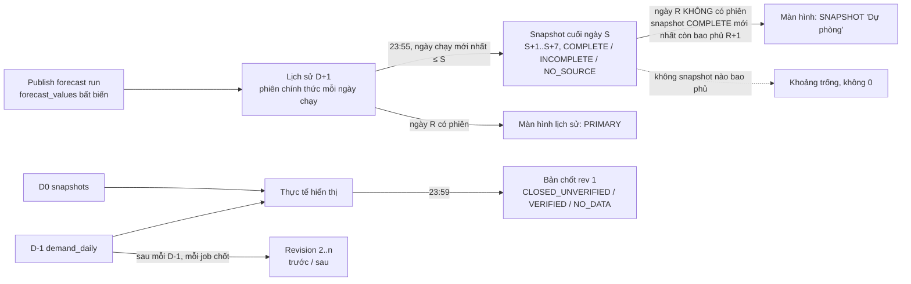

# Demand Forecasting — WAPE D-0, snapshot forecast cuối ngày (7 ngày), chốt thực tế 23:59

Ngày: 18/10/2026. Mã nguồn: phiên bản **1.2.6, chưa phát hành**. Cơ sở: commit `d60f81e` (production đang chạy 1.2.5).

**Trạng thái: `READY_FOR_PRODUCTION` về mã nguồn và kiểm thử cách ly — `NOT VERIFIED — Production`.**
Chưa đóng gói, chưa deploy, chưa push. Production không bị tác động.

| Tiêu chí (prompt mục 14) | Kết quả | Loại bằng chứng |
|---|---|---|
| 1. WAPE cập nhật sau mỗi D-0, logic không đổi | PASS | Unit/Regression + DB copy |
| 2. Snapshot độc lập, đủ 7 ngày | PASS | Integration DB cách ly + DB copy |
| 3. Forecast chính luôn ưu tiên | PASS | Integration DB cách ly + DB copy |
| 4. Fallback khi không có forecast hợp lệ | PASS | Integration DB cách ly + DB copy (ngày mô phỏng) |
| 5. Không có số giả, không điền 0 | PASS | Integration DB cách ly |
| 6. Chốt đúng ngày nghiệp vụ, trạng thái trung thực | PASS | Integration DB cách ly + DB copy |
| 7. Retry / idempotency / đồng thời | PASS | Integration DB cách ly |
| 8. Forecast bất biến khi actual đổi | PASS | Integration DB cách ly + DB copy (fingerprint 8 bảng) |
| 9. UI / API / Excel đúng nguồn và trạng thái | PASS | Integration (API, Excel) + Static/Build/Frontend QA |
| 10. Migration và regression | PASS | DB cách ly + DB copy |
| 11. Mọi test chạy trên môi trường cách ly | PASS | Fixture kiểm tra đường dẫn DB |
| 12. Không thay đổi ngoài phạm vi | PASS | Rà diff |
| 13. Production chưa bị tác động; không deploy, không push | PASS | Kiểm tra chỉ đọc lúc 12:08 |
| Production | **NOT VERIFIED** | Chưa deploy |

## 1. Tóm tắt thay đổi

- **A. WAPE trong ngày:** giữ nguyên công thức, mẫu số, phạm vi dòng, cách làm tròn và cách hiển thị.
  - WAPE = Σ|F − T| / ΣT trên các dòng đã có thực tế.
  - Thêm test hồi quy khóa hành vi: WAPE tính lại sau mỗi lần D-0, bằng đúng `ml/metrics.py`.
- **B. Snapshot forecast cuối ngày.**
  - Job mới `EOD_FORECAST_SNAPSHOT`, mặc định 23:55 giờ Việt Nam.
  - Lưu bản sao đầy đủ 7 ngày dự báo kế tiếp (S+1 … S+7) từ phiên forecast hợp lệ mới nhất.
  - Chỉ dùng cho ngày chạy **không có** phiên hợp lệ; gắn nhãn "Dự phòng" kèm ngày snapshot, giờ tạo và run nguồn.
- **C. Chốt thực tế 23:59.**
  - Job mới `ACTUAL_CLOSE`. Lưu bản chốt độc lập (revision 1); dữ liệu đến muộn tạo revision bổ sung có số trước/sau.
  - Không có tín hiệu hoàn tất của nguồn thì trạng thái là **"Đã chốt – cần xác minh"**, không phải "Đã hoàn tất".
- Production hiện **không** cấu hình tín hiệu hoàn tất. Vì vậy sau khi deploy, ngày đã chốt sẽ hiện "Đã chốt – cần
  xác minh" cho tới khi có tín hiệu.

## 2. File đã sửa

| Nhóm | File |
|---|---|
| Schema | `backend/app/migrations/0005_eod_backup_actual_close.sql` (mới, chỉ thêm bảng + trigger) |
| Logic mới | `backend/app/forecast_backup.py`, `backend/app/actual_close.py` (mới) |
| Lịch sử / fallback / Excel | `backend/app/forecast_history.py`, `backend/app/export_i18n.py` |
| API | `backend/app/api/history_routes.py` (chỉ thêm trường / tham số), `backend/app/api/data_routes.py` (công tắc mới chỉ đổi qua trang Lịch) |
| Scheduler / job | `backend/app/jobs/scheduler.py`, `jobs/runner.py`, `jobs/flows.py`, `jobs/progress.py`, `backend/app/settings_service.py` |
| Dữ liệu đến muộn | `backend/app/sync.py` (một lời gọi sau commit của D-1, không làm D-1 thất bại) |
| Thông điệp / kiểm tra | `backend/app/messages.py`, `backend/app/data_checks.py` |
| UI | `frontend/src/pages/ForecastHistory.tsx`, `pages/Schedules.tsx`, `pages/Jobs.tsx`, `components/ui.tsx`, `styles.css`, `i18n.tsx` |
| Phiên bản | `backend/app/__init__.py`, `frontend/package.json`, `frontend/package-lock.json` → 1.2.6 |
| Test | mới: `backend/tests/test_v126_eod_backup_close.py` (18 test), `frontend/src/v126.test.tsx` (4 test); sửa assertion: `test_v125_forecast_history.py`, `test_v118.py` (mục 9) |
| Tài liệu | `docs/LICH-SU-FORECAST.md` (mục 10–13 mới), `docs/SCHEDULER.md`, `docs/data/DATA-MODEL.md`, `docs/data/DATA-DICTIONARY.md`, `docs/VAN-HANH.md`, `docs/UI-DESIGN-SYSTEM.md`, `AGENTS.md`, `CHANGELOG.md`, `docs/CHECKPOINT.md` |

**Không đổi:**
- `scripts\` (kể cả proxy chỉ đọc) và `storage.json`;
- lịch D-0 / D-1 / huấn luyện;
- SQL và mapping BigQuery;
- quality gate, ngưỡng WAPE / bias;
- `dist\`.

## 3. Luồng dữ liệu



## 4. Snapshot và phạm vi 7 ngày

- **Quy ước đã xác minh trong code.** `forecast_origin` = ngày chạy, tức horizon 1 là chính ngày đó. D+1 = ngày chạy + 1
  (`forecast_history._record`). Mọi SKU × FC có đủ mọi ngày trong horizon (kiểm tra trên bản sao: 17.125 / 17.127 chuỗi
  ở mỗi ngày).
- **Phạm vi:** 7 ngày kế tiếp của ngày nghiệp vụ S là **S+1 … S+7**, không gồm S.
- **Nguồn:** phiên chính thức của ngày chạy mới nhất ≤ S (dùng lại quy tắc chọn phiên của 1.2.5).
- **Trạng thái:**
  - `COMPLETE` khi run nguồn có đủ mọi chuỗi ở cả 7 ngày; bản sao được kiểm số dòng và tổng ngay trong transaction.
  - Thiếu ngày → `INCOMPLETE`; không có phiên → `NO_SOURCE`. Cả hai không lưu giá trị nào và có alert WARNING.
- **Idempotent:** UNIQUE (scope, ngày nghiệp vụ); snapshot `COMPLETE` bất biến (trigger). Chỉ dòng chưa hoàn chỉnh của
  cùng ngày mới được hoàn thành ở lần sau.
- **Đồng thời:** `BEGIN IMMEDIATE` + khóa job.
- **Chờ phụ thuộc:** đợi job huấn luyện / forecast đang chạy, tối đa tới 06:00 hôm sau.
- **Fallback (chỉ đọc):** chi tiết ở `docs/LICH-SU-FORECAST.md` mục 11.

## 5. Chốt thực tế 23:59 và dữ liệu đến muộn

- **Ngày nghiệp vụ** = ngày Việt Nam của mốc lịch, mang trong `params.business_date`; retry / chạy bù sau nửa đêm vẫn
  đúng ngày. Chốt trước 23:59 bị từ chối.
- **Revision 1** = bản sao thực tế đang hiển thị: D-1 nếu đã nạp, nếu chưa thì snapshot D0 cuối. Chỉ copy các dòng có
  trong nguồn. Ngày không dữ liệu là `CLOSED_NO_DATA`, tổng NULL.
- **Tín hiệu hoàn tất:** có cơ chế sẵn là audit `D1_SYNC` mode `SIGNAL` (bảng `bigquery.completion_table`). Production
  chưa cấu hình, nên không tự tạo tín hiệu: D0 / D-1 không tín hiệu → `CLOSED_UNVERIFIED` ("Đã chốt – cần xác minh").
- **Đến muộn:** `reconcile()` chạy sau mỗi lần D-1 thành công (sau commit) và trong mỗi job chốt, với 14 ngày gần nhất.
  - Thêm revision mới với lý do, tổng trước/sau, số dòng đổi/thêm/bớt.
  - Không đổi thì không ghi. Revision cũ bất biến.
- **Con số hiển thị** vẫn đọc từ nguồn như 1.2.5. Bản chốt chỉ thêm trạng thái `CLOSED` và dấu vết (revision, thời
  điểm, nguồn).

## 6. Quy tắc WAPE đã giữ nguyên

- Không sửa công thức, mẫu số, phạm vi SKU × FC hay hiển thị.
- **Test** `test_wape_is_recomputed_after_each_d0_update_with_the_unchanged_formula`: sau 3 lần D-0 (08:00 = 0,
  10:00, 12:00), WAPE lần lượt là:
  - không tính (tổng thực tế = 0);
  - 29,5 / 5;
  - 23,5 / 11.
  Mỗi lần bằng đúng `ml.metrics.compute`. Forecast và job không đổi.
- **Bản sao DB production:** WAPE ngày chạy 17/10 = 18,3232 (1.832%), giống hệt khi có và không có lớp chốt. Chỉ nhãn
  đổi `PROVISIONAL` → `CLOSED`.

## 7. Migration và rollback

- **0005 chỉ thêm 4 bảng + 11 trigger + 1 chỉ mục;** không sửa bảng hay dòng cũ.
- **Trên bản sao DB production:**
  - schema 4 → 5;
  - fingerprint sha256 của 8 bảng giống hệt trước/sau: `forecast_runs`, `forecast_values`, `forecast_history_*`,
    `training_runs`, `demand_daily`, `d0_snapshot_values`;
  - chạy migrate lần hai không áp dụng gì;
  - `data-check` WARN trước và sau với cùng một kiểm tra có sẵn (`forecast_series_meta`); 3 kiểm tra mới OK.
- **Rollback.** 1.2.5 từ chối DB schema 5, và `rollback-version.ps1` cũng từ chối. Cách làm:
  1. khôi phục bản `pre-migration-v4` (app tự tạo khi migrate) hoặc bản backup trước deploy;
  2. chạy `rollback-version.ps1 -To 1.2.5`.

  Mất snapshot và bản chốt ghi sau nâng cấp, cùng mọi dữ liệu khác ghi sau thời điểm đó.
- **Dung lượng (đo trên bản sao):**
  - 1 snapshot = 119.889 dòng ≈ **11,8 MB/ngày** (≈ 4,3 GB/năm);
  - bản chốt ≈ 0,5–3k dòng/ngày.
  - Chưa có chính sách lưu giữ; trigger cấm xóa.

## 8. Lệnh test đã chạy

| Lệnh | Môi trường | Kết quả |
|---|---|---|
| `python -m pytest -q -p no:cacheprovider tests/test_v126_eod_backup_close.py` | DB tạm (conftest; fixture khẳng định không phải DB thật) | 18 passed |
| `python -m pytest -q -p no:cacheprovider` (toàn bộ backend, lượt cuối) | DB tạm | **457 passed, 7 skipped** (5 phút 36 giây, 12:08–12:13). 7 test bỏ qua là test BigQuery thật cần `DF_REAL_BQ=1`, như trước |
| `npm test` | jsdom, fetch giả | **18 file, 110 passed** (106 cũ + 4 mới) |
| `npm run typecheck` | — | OK (exit 0) |
| `npm run build` | — | OK (exit 0) |
| `integ126.py copy2` | bản sao DB production (backup API, nguồn `mode=ro`, lúc 12:00:32), `DF_DATA_DIR` / `DF_STORAGE_CONFIG` / `LOCALAPPDATA` riêng, `DF_DISABLE_SCHEDULER=1` | PASS (mục 9) |
| `prod_fp_after_1200.py` (thuộc nhiệm vụ 1.2.5) | production, chỉ GET | bản D+1 17/10 vẫn `b43dda4f…4754` sau D-0 12:00 |
| Lint | — | không cấu hình |

Script và kết quả nằm trong scratchpad
`C:\Users\GIAUVO~1\AppData\Local\Temp\claude\d--Buymed-Lightgbm-AI\672ca914-ddf0-41a6-b294-d1210c881018\scratchpad\p3\`:
`integ126.py`, `integ126_result.json`, `integ126_history_17_18.xlsx`, `backend_final.log`, `frontend_final.log`.

## 9. Kết quả pass / fail / blocked

**PASS — Integration Test trên DB cách ly (`test_v126_eod_backup_close.py`, 18 test).**

- **A. WAPE và D-0:**
  - WAPE tính lại sau mỗi D-0, đúng công thức; forecast và job không đổi;
  - D-0 chạy lại cùng job id chỉ có 1 snapshot.
- **B. Snapshot:**
  - đủ 7 ngày, đúng grain, đúng run / model nguồn; run của ngày sau S không được dùng;
  - chạy lại và 4 luồng đồng thời → 1 snapshot, không đổi; trigger chặn UPDATE / DELETE;
  - không có forecast → `NO_SOURCE`, job `SKIPPED`, 0 giá trị, có alert;
  - nguồn thiếu ngày → `INCOMPLETE` (4/7, liệt kê ngày thiếu), không dùng làm dự phòng; phiên hợp lệ xuất hiện sau
    thì hoàn thành đúng bản ghi đó;
  - chờ job huấn luyện đang chạy, giữ ngày nghiệp vụ khi chạy sau 06:00 hôm sau.
- **C. Fallback:**
  - chọn snapshot mới nhất còn bao phủ; ngày có phiên luôn là `PRIMARY`;
  - snapshot hết bao phủ → ngày trống; SKU × FC thiếu không thành 0;
  - phiên mới xuất hiện thì quay về `PRIMARY`; snapshot không đổi;
  - đọc API / Excel không ghi bảng nào (đếm 14 bảng trước/sau); bộ lọc `forecast_source`; Excel H2.
- **D. Chốt:**
  - 19/10 03:00 giờ VN (= 18/10 UTC) chốt ngày 18/10, không lệch UTC; chốt sớm bị từ chối;
  - retry / 4 luồng đồng thời → 1 revision; trigger chặn sửa và revision không liên tiếp;
  - không dữ liệu → `CLOSED_NO_DATA`, không 0; không tín hiệu → `CLOSED`, không bao giờ `COMPLETE`;
  - đến muộn: D1_LOADED (5 → 19), D1_RELOADED (19 → 14), COMPLETION_SIGNAL_CONFIRMED → `COMPLETE`; revision 1 giữ
    nguyên; fingerprint forecast và số job không đổi.
- **E. Scheduler:**
  - mốc cuối ngày mang ngày nghiệp vụ của mốc; 00:10 vẫn chốt ngày hôm trước;
  - chạy bù hôm qua đúng một lần; ngày cũ hơn ghi `MISSED_SLOT_NO_BACKFILL`;
  - không có mốc "lần đầu thấy" thì không chạy; tick đầu tiên không chạy bù slot trước nó;
  - hai scheduler / khởi động lại → 1 job;
  - API lịch có 2 flow mới; giờ 08:00 bị từ chối 422; công tắc không đổi được qua trình sửa thiết lập chung.
- **F. Migration 0005 trên DB v4:** số dòng và tổng forecast giữ nguyên; migrate lần hai không làm gì; `data-check` OK/WARN.

**PASS — Integration Test trên bản sao DB production (`integ126.py copy2`).**

| Bước | Kết quả |
|---|---|
| Migrate 4 → 5 | 8 bảng giống hệt; migrate lần hai `[]` |
| Snapshot 18/10 (23:56 mô phỏng) | `COMPLETE`, nguồn `FCR-20261018043737-798B4D` (run date 18/10), 19/10 → 25/10, **119.889 dòng = 7 × 17.127**, tổng 597.314,1304, sha256 khớp nguồn, 1,04 s, +11,76 MB; chạy lại: `already_complete`, cùng id |
| Chốt 17/10 (lúc 12:00) | nguồn **D1** (lần D-1 thủ công 08:56), 2.983 dòng, tổng 68.598, `CLOSED_UNVERIFIED` (`D1_NO_COMPLETION_SIGNAL`), cutoff 17/10 16:59 UTC |
| Chốt 18/10 (23:59:30) | nguồn **D0** `SNP-20261018050026-A83982`, 529 dòng, tổng 3.764, `CLOSED_UNVERIFIED`; chốt lại: `already_closed`; đối soát: 0 revision |
| Màn hình 19/10 10:00 | 17/10 `PRIMARY` FCC0EB, thực tế `CLOSED`; 18/10 `PRIMARY` 798B4D |
| Fallback (ngày mô phỏng trên bản sao) | snapshot 19/10 `COMPLETE`; lúc 20/10 10:00, ngày chạy 19/10 và 20/10 (không có phiên) = `SNAPSHOT` `FES-20261019165600-4991E7`, 17.127 dòng/ngày; **0 dòng khác giá trị nguồn**; KPI 2 ngày chính + 2 ngày dự phòng |
| Excel 17–18/10 | 34.252 dòng, 4 sheet, 4 cột mới ở cuối, 3,07 MB, 7,2 s |
| Sau mọi bước | 8 bảng forecast / dữ liệu giống hệt; `data-check` 3 kiểm tra mới OK |

**PASS — Static/Build/Frontend QA.** `npm test`, typecheck, build: xem mục 8.
- Test mới: nhãn "Dự phòng 17/10" + tooltip run nguồn, bảng snapshot dự phòng, KPI "Đã chốt – cần xác minh" (không
  có "Đã hoàn tất"), điểm biểu đồ dự phòng, bộ lọc nguồn tới summary / rows / Excel, thẻ lịch `eod` / `close` lưu đúng
  flow.
- Test 1.2.5 (`v125-history.test.tsx`, 11 cột bảng) vẫn đạt.

**Test cũ đã sửa assertion (thay đổi có chủ đích, không làm yếu kiểm tra):**
- `test_v125_forecast_history.py::test_migration_0004_on_a_v3_database…` khẳng định đích là schema 4. Nay migrate từ
  v3 đi tiếp tới 0005, nên kiểm tra "0004 được áp dụng trước, đích = migration mới nhất". Phần giữ dòng và ghi nhận
  run giữ nguyên.
- `test_v118.py::test_restart_restores_the_saved_state`: scheduler nạp 5 flow (thêm `eod`, `close`) thay vì 3.

**FAIL:** không có. **BLOCKED:** không có trong phạm vi test cách ly.

**Rà soát độc lập (agent data-reviewer, chỉ đọc):** "SAFE WITH CONDITIONS". Đã xử lý:
- validate giờ cuối ngày (20:00–23:59);
- data-check không quét toàn bảng snapshot;
- bỏ chỉ mục trùng;
- đối soát chỉ quét nguồn một lần, ngoài khóa ghi.

Còn lại, đã ghi ở mục 13:
- job EOD ghi nhận bù run đã publish (`forecast_history.reconcile()`, hành vi có sẵn lúc khởi động);
- dung lượng;
- snapshot INCOMPLETE chỉ được hoàn thành khi chạy tay.

## 10. Không ghi dữ liệu production

- **Production chỉ được truy cập theo hai cách:**
  - `GET /api/health`, `/api/schedules`, `/api/jobs`, `/api/history/*`;
  - hai bản sao bằng SQLite backup API với nguồn mở `mode=ro`.
- **Test và kiểm thử tích hợp** chỉ ghi vào DB tạm hoặc bản sao trong scratchpad. Script khẳng định
  `paths.db_path()` ≠ DB thật trước khi chạy.
- **Thay đổi trên production trong lúc làm việc đều do chủ sở hữu thao tác qua UI**, không do nhiệm vụ này (audit /
  job):
  - 11:26 job huấn luyện thủ công (SKIPPED);
  - 11:37:47 duyệt model ứng viên `TRN-20261018020140-642DB8` → publish `FCR-20261018043737-798B4D` (có cảnh báo);
  - 11:40:57 lưu lịch D-1 (nay 03:00, dự phòng 05:00).

## 11. Không deploy, không push, không đổi lịch

Kiểm tra chỉ đọc lúc 12:08:

| Mục | Kết quả |
|---|---|
| Ứng dụng | 1.2.5 (`current.txt` 1.2.5), pid 22024, không có job đang chạy |
| `storage.json` | hash `8D79DBDD` (không đổi) |
| Lịch | D-1 BẬT 03:00 / dự phòng 05:00 (chủ sở hữu đổi lúc 11:40); D-0 BẬT 08:00–18:00 mỗi 2 giờ; huấn luyện BẬT 09:00. Nhiệm vụ này không đổi lịch nào. |
| URL / proxy | Link `https://volumes-jean-angels-configurations.trycloudflare.com` trả 200 (1.2.5); POST bị chặn 405; proxy pid 26416 và cloudflared pid 31076 không đổi |
| Git | không push; không có package mới trong `dist\`; không xóa gì trong `dist\` |

## 12. Git

- Checkpoint trước khi sửa: `checkpoints/checkpoint-20261018-v126-eod-close-before.zip`, SHA-256
  `BA60CE4E0E33B9F5F1B500EC92A347FA729AE5D07FD0ABFFF4C4A8AC5CABECE5`. File này nằm ngoài Git.
- Commit cục bộ (chưa push; `main` đi trước `origin/main` 18 commit):
  - `581fcdc` — mã + test (28 file);
  - `ba74335` — tài liệu (9 file).
- Working tree sạch sau commit.
- `git diff --cached --name-only` không có file cấm; quét secret trên dòng thêm mới không có kết quả. Bộ lọc khớp nhầm `docs/data/…`; đây là tài liệu đã được version từ trước.
- File báo cáo này **không** nằm trong Git, vì `reports/` bị `.gitignore` bỏ qua theo quy định dự án.

## 13. Giới hạn chưa xác minh

1. **Production chưa được kiểm chứng.** Chưa đóng gói 1.2.6, chưa deploy. Mọi PASS ở trên là test cách ly hoặc bản sao
   DB.
2. **Chưa có tín hiệu hoàn tất của nguồn.** Sau deploy, không ngày nào "Đã hoàn tất"; ngày đã chốt là "Đã chốt – cần
   xác minh". Muốn có "Đã hoàn tất" cần chủ sở hữu cấu hình bảng tín hiệu hoàn tất BigQuery (quyết định nghiệp vụ).
3. **Bản chốt 23:59 dùng lần đọc D-0 cuối cùng (18:00)**, nên chưa có đơn sau 18:00. Đơn này đến qua D-1 hôm sau và
   được ghi thành revision. Nhiệm vụ không đổi giờ D-0.
4. **Dung lượng:** khoảng 11,8 MB/ngày. Cần chủ sở hữu quyết định thời hạn lưu; việc dọn cần một migration riêng.
5. **Ghi nhận bù lịch sử.** Job EOD gọi `forecast_history.reconcile()` (idempotent, như lúc khởi động) để ghi nhận run
   đã publish mà lịch sử chưa có. Việc này có thể chuyển con trỏ của một ngày chạy sang phiên hợp lệ mới hơn của cùng
   ngày, đúng quy tắc 1.2.5. Nó không tạo forecast.
6. **Snapshot `INCOMPLETE` / `NO_SOURCE`** chỉ được hoàn thành khi chạy tay ("Chạy ngay 1 lần" của flow `eod`). Lịch
   không tự thử lại vì nguồn không đổi.
7. **Lần deploy đầu:** hai flow mới bắt đầu từ mốc **sau** lần tick đầu tiên của 1.2.6. Deploy trong ngày thì snapshot
   / bản chốt đầu tiên là 23:55 / 23:59 cùng ngày. Không tạo bản cho ngày cũ.
8. **Proxy chỉ đọc:** không cần sửa vì đường dẫn API không đổi. Trang Lịch vẫn bị chặn qua link (admin 403).

## 14. Kiểm tra một lượt và các bước triển khai (khi được duyệt)

**Kiểm tra lại một lượt (không đụng production):**

```powershell
cd "D:\Buymed\Lightgbm AI\backend"; ..\.venv\Scripts\python.exe -m pytest -q -p no:cacheprovider
cd ..\frontend; npm test; npm run typecheck; npm run build
# hoặc: powershell -ExecutionPolicy Bypass -File scripts\run-tests.ps1
```

**Triển khai production (chỉ khi chủ sở hữu duyệt rõ cho đợt này):**

1. Quyết định trước: (a) giữ mặc định BẬT 23:55 / 23:59 hay tắt sau deploy; (b) thời hạn lưu snapshot.
2. Push / tag theo `docs/GITHUB_WORKFLOW.md` nếu được phép. Sau đó chạy
   `scripts\release.ps1` → `dist\DemandForecast-1.2.6-win64-portable.zip` + `.sha256`.
3. Diễn tập trên bản sao chỉ đọc + `LOCALAPPDATA` cách ly:
   - `deploy-upgrade.ps1 -CheckOnly`, rồi deploy 1.2.6;
   - kiểm tra schema 5, số dòng cũ không đổi, `data-check`, trang Lịch có 2 flow mới;
   - kiểm tra trang lịch sử qua proxy (proxy 1.2.5 không cần khởi động lại vì allowlist không đổi);
   - diễn tập rollback: khôi phục backup trước nâng cấp + `rollback-version -To 1.2.5`.
4. Deploy thật ngoài mốc lịch, khi không có job đang chạy (tránh 08:00–18:00 chẵn giờ, 03:00, 09:00):
   `scripts\deploy-upgrade.ps1 -Package <zip> -ExpectedSha256 <sha>`, xác nhận `UPGRADE-1.2.6`.
5. Sau deploy, kiểm tra chỉ đọc:
   - phiên bản, schema 5, `data-check`;
   - lịch D-0 / D-1 / huấn luyện không đổi;
   - link và proxy;
   - 23:55 / 23:59 tối đó có job `EOD_FORECAST_SNAPSHOT:<ngày>` / `ACTUAL_CLOSE:<ngày>`;
   - sáng hôm sau, ngày vừa chốt hiện "Đã chốt – cần xác minh"; sau D-1 có revision `D1_LOADED`.
6. Rollback nếu cần: khôi phục backup `pre-migration-v4` hoặc backup trước deploy bằng `restore.ps1` của 1.2.5, rồi
   `rollback-version.ps1 -To 1.2.5`.
