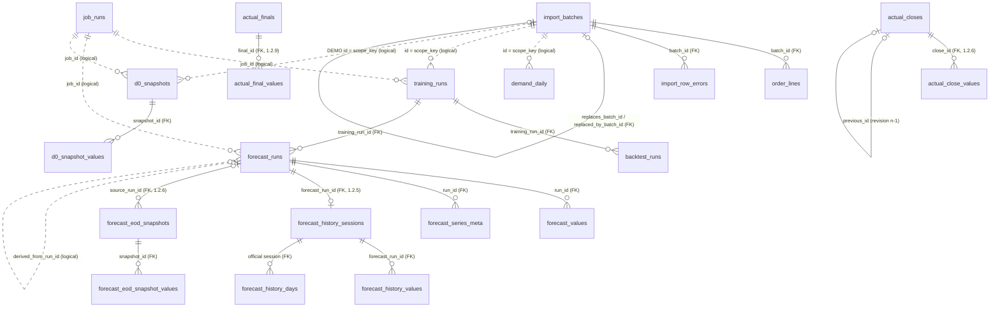
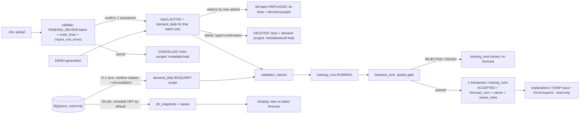

# Data model, lifecycle and data rules (current state, schema 6 since 1.2.6: end-of-day forecast backup, actual close and the 90-day backup retention added; schema 4 since 1.2.5: D+1 forecast history; source after 1.2.8, not deployed: schema 8, SKU open hours (0007) and customer counts (0008) on `demand_daily`)

Status: verified against the code in `backend/app` and a read-only copy of the live database on 2026-10-15
(application 1.1.6 deployed, 1.1.7 source; schema version 3). Column-level detail: [DATA-DICTIONARY.md](DATA-DICTIONARY.md).
Storage locations: [../LUU-TRU.md](../LUU-TRU.md). BigQuery: [../BIGQUERY.md](../BIGQUERY.md).
Anything marked **UNKNOWN** could not be verified from the code or the database and must not be assumed.

## 1. Sources of truth

| Data | Authoritative store | Notes |
|---|---|---|
| Order lines of a DEMO / Excel dataset | `order_lines` (per `batch_id`) | Each `.xlsx` import = one independent batch; DEMO = generated batch |
| Daily demand used for training | `demand_daily` (per `scope_key`) | Built from `order_lines` (DEMO / MANUAL_IMPORT) or loaded from BigQuery (D-1 sync) |
| BigQuery history (intended primary source) | `lakehouse-prod-394907.gold_buymed_vn2.demand_planing_lightgbm` (or a validated history SQL) | Read-only. The app keeps only the daily aggregate in `demand_daily`; it never writes to BigQuery |
| Intraday (D0) demand | `d0_snapshots` + `d0_snapshot_values` | One immutable snapshot per successful read |
| Models | `training_runs` row + file `<models>/<model_version>.txt` | File integrity: `training_runs.model_sha256` |
| Published forecasts | `forecast_runs` + `forecast_values` + `forecast_series_meta` | Immutable (triggers) |
| D+1 forecast history (1.2.5, schema 4) | `forecast_history_sessions` + `forecast_history_values` + `forecast_history_days` | Copy of the D+1 values of the official session per run date, taken from `forecast_values`; sessions / values immutable, only the per-day pointer moves (audited). Actual is NOT stored: read from `demand_daily` / `d0_snapshots`. Rules: [../LICH-SU-FORECAST.md](../LICH-SU-FORECAST.md) |
| End-of-day forecast backup (1.2.6, schema 5) | `forecast_eod_snapshots` + `forecast_eod_snapshot_values` | Per scope and business day S, a copy of S+1..S+7 of the official session of the newest run date <= S; values only for a COMPLETE snapshot; never changed. Used for display only for a run date without an official session. NOT a source of truth: `forecast_values` stays it. Kept 90 days (schema 6, below): deleted only by the operator's retention run |
| Backup retention record (1.2.6, schema 6) | `forecast_eod_snapshot_retention` | One permanent row per deleted snapshot (what, when, cutoff, backup). Its DELETING row is also the only permit the triggers accept for a DELETE, for a business date older than today (Vietnam) - 90 days. Never deleted; DELETING -> DELETED once (`eod_retention.py`, LICH-SU-FORECAST.md section 14) |
| Actual close at 23:59 (1.2.6, schema 5) | `actual_closes` + `actual_close_values` | Independent copy of the day's actual as shown at the close (revision 1) and immutable, consecutive revisions for late data. The figure on screen is still read from `demand_daily` / `d0_snapshots`; the close adds the status CLOSED and the trace |
| Finalized actual (1.2.9, schema 9) | `actual_finals` + `actual_final_values` | Frozen copy of a completed day's actual (SKU x FC) written from the verified D-1 load that wrote it, with that load's provenance; sealed, immutable (triggers). BLOCKED days carry the reason. The history page shows a finalized day from this copy only (docs/LICH-SU-FORECAST.md section 15) |
| Settings | `app_settings` (+ `settings_history`) **and code defaults** | See section 9 |
| Storage location | `%LOCALAPPDATA%\DemandForecast\storage.json` + `storage-id.json` in the data folder | Per Windows user; `paths.py` is the only resolver |
| Google OAuth client secret + refresh token | Windows Credential Manager of the Windows user running the app | Never in the DB, files, logs or backups (`bq/secret_store.py`) |
| Active data source | `app_settings.general.active_source` | Changed by the user in the UI only |

There is one SQLite database per installation (WAL mode). Splitting it or changing the engine is **not** justified by
any finding below.

## 2. Entity-relationship diagram (verified)

Solid lines are real `FOREIGN KEY` constraints (`PRAGMA foreign_keys=ON` on every connection, `db.connect`).
Dotted lines are logical references held only by convention in code (no constraint).

Not drawn: `validation_reports.scope_key`, `forecast_runs.scope_key` (logical, same rule as `demand_daily`);
`alerts.entity_*` and `audit_log.entity_*` (polymorphic: batch, job, forecast run, scope, snapshot); `app_settings`,
`settings_history`, `sync_state`, `job_locks`, `schema_migrations` (stand-alone). `forecast_runs.model_version` duplicates
`training_runs.model_version` (UNIQUE) on purpose: published runs are self-describing.

`scope_key` = exactly one dataset: the ACTIVE DEMO batch id, the MANUAL_IMPORT batch id chosen in settings, or
`BIGQUERY:<project>.<dataset>.<table>`. Every query, aggregate, training, forecast and snapshot is filtered by it;
sources are never mixed.

## 3. Lifecycle

Guarantees verified in code and tests:

* Confirm, replace, delete and cancel run in one `BEGIN IMMEDIATE` transaction (`importer.py`).
* Replacing or deleting batch A deletes only rows whose `batch_id` / `scope_key` is A, even when other batches have the
  same dates, SKU, FC and order ids. Tests: `test_import.py::test_replace_batch_only_affects_selected_batch` and
  `test_replace_and_delete_keep_other_batches_with_identical_dates_sku_fc`.
* Published forecasts survive replacement or deletion of their batch (`test_api.py::test_published_forecast_survives_batch_replacement`).
* A training run is ACCEPTED only together with its forecast run, in one transaction
  (`test_v111.py::test_publish_failure_after_training_keeps_previous_forecast`).
* The D-1 sync writes the date window in one transaction and rolls back unless the written rows and quantity equal what
  was read (`BQ_SYNC_RECONCILIATION_FAILED`). A change of mapping, range or history SQL forces a full reload of the scope.
* 1.2.9: a history **backfill** (user request) replaces only its window and only after a READY read-only preview of the
  same window, mapping and SQL (`sync_state bq_backfill_preview`, at most 6 h old, used once). Inside the write
  transaction the job checks again that the preview is still READY, that no D-1 load ran since, and that the
  new / updated / removed rows equal the previewed counts; otherwise `BACKFILL_PREVIEW_REQUIRED` and nothing is written.
  A verified online backup is made right before the write (`BACKFILL_BACKUP_FAILED` = nothing written). A backfill never
  moves the D-1 watermark and never triggers a training. Tests: `test_v129_backfill_history_patterns.py`.
* 1.2.9: a backup zip is written under a temporary name, checked (`testzip`) and only then renamed `backup-*.zip`.
* 1.2.9b: a reload (backfill, full D-1 reload) that would turn stored OK open hours into another status or remove the row
  is announced by the preview (`OPEN_HOURS_WOULD_BE_LOST`) and counted in the result (`open_hours_lost`): the source keeps
  open hours for about its last 7 months only, so re-reading older days replaces stored values by MISSING.
* A D0 snapshot is written only after a successful read; a retried job never writes a second snapshot (`job_id`).

## 4. Keys, uniqueness and deduplication

| Level | Key | Enforced by |
|---|---|---|
| Batch | `import_batches.id` | PK |
| One ACTIVE DEMO batch | `data_source='DEMO' AND status='ACTIVE'` | partial UNIQUE index (0002) |
| Order line | grain order_id x SKU x FC within a batch | import validation: exact duplicates -> `DUPLICATE`, grain conflicts -> ERROR or SUM (`import.grain_conflict_policy`, default ERROR). Not a DB constraint |
| Daily demand | scope_key x order_date x SKU x FC | PK |
| BigQuery rows | candidate key (order, SKU, FC, date) derived from the mapping, or `sql_sources.*.key_columns` | key gate in `bq/connector.py` (BLOCK by default -> `BQ_KEY_NOT_UNIQUE`); exact duplicates per `exact_duplicate_policy` (BLOCK/KEEP/DROP_EXACT) |
| Forecast value | run x SKU x FC x target_date | PK + immutability triggers |
| D0 value | snapshot x SKU x FC | PK + no-update trigger |
| Job | `idempotency_key` (e.g. `D0_SYNC:2026-10-15T16:00`) | UNIQUE |
| Model | `model_version` | UNIQUE; file hash `model_sha256` |

Rows that are not in `demand_daily` mean "no recorded demand" for that day; the training panel treats days without rows
of an active series as zero demand (business rule of the original specification: target = quantity ordered at order
creation, cancellations not subtracted). Invalid input rows are never converted to zero: they are rejected and listed in
`import_row_errors` (Excel) or counted as `rows_error` / `excluded_by_reason` (BigQuery).

SKU open hours (schema 7, migration 0007, `app/data/open_hours.py`): a day without a row has **unknown** open hours
(never 0). `demand_daily.open_hours` holds a value only with `open_hours_status = 'OK'` (every order line of the day x
SKU x FC has a value, all equal, within 0..24); MISSING / OUT_OF_RANGE / CONFLICT rows keep NULL; a NULL status means
not loaded (rows written before 1.2.9) or not applicable (DEMO / Excel sources have no such column). The BigQuery
training stops (`OPEN_HOURS_INVALID`) while any row of the data window is not OK. `data-check` verifies the status
values, value-only-when-OK, BIGQUERY-only and reports the window state (`open_hours_*`).
1.2.9b: `MULTI_ITEM` = the lines differ only between items (open hours are measured per item code `<sku_code>.<n>` and
day; several items of the SKU served by the FC that day). The suffix `<n>` is the order in which the SKU was opened for
sale in the regions, not a region code (owner, 20/10/2026): nothing (FC, region, hours) is inferred from it. No value at
this grain, still not OK for the training until an aggregation rule is approved. Model-input start rule `data_policy.training_start_rule`:
`OPEN_HOURS_COVERAGE` starts training, backtest, forecast panel and the checks at the first STORED day with open hours
(computed from the rows at each use); the earlier days stay stored and loaded (never deleted), each run records what was
left out (`data_window.excluded_summary`).

Customer counts (schema 8, migration 0008, `app/data/customers.py`): `customer_count`, `repeat_customer_count`,
`repeat_interval_days_sum` per day x SKU x FC, computed inside BigQuery from the optional `bigquery.customer_id_column`
(default none); NULL = unknown. No customer identifier is stored or fetched. Used as model input only with
`model.feature_customer` ON (default OFF) and enough coverage. `data-check customer_counts_consistent`.

## 5. Time and timezone

| Item | Interpretation | Where |
|---|---|---|
| Stored timestamps (`*_at`, `created_at` of app rows) | UTC ISO-8601 with offset, second resolution | `timeutil.now_iso` |
| Business dates (`order_date`, `target_date`, `forecast_origin`, `data_as_of`) | Vietnam calendar date `YYYY-MM-DD` | `timeutil.today_vn`, VN_TZ = Asia/Ho_Chi_Minh |
| Excel `created_at` without offset | Asia/Ho_Chi_Minh; with offset converted to VN | `data/validation.py` |
| Excel `order_date` | taken as given; else date of `created_at` in VN | `data/validation.py` |
| BigQuery history `order_date` | `DATE(order_date_column)` if mapped, else from `created_at`: `DATE(TIMESTAMP(col), 'Asia/Ho_Chi_Minh')` when `created_at_is_utc=true` (default), else `DATE(col)` | `connector._order_date_expr` |
| Day of `total_open_hours` (1.2.9) | the `order_date` of its order line (production: the DATE column `created_date`). The source's own day basis for the hours is **UNKNOWN until confirmed** by the table owner | `connector._daily_sql` |
| Day of week (1.2.9) | 1 = Monday ... 7 = Sunday of the business date itself (never a timestamp); models before 1.2.9 keep dow 0..6 | `app/weekday.py`, `ml/features.dow_value` |
| BigQuery D0 SQL v1 (user, verbatim) | `DATE(a.created_at)` - correct only if `created_at` is a VN-local DATETIME. **UNKNOWN until the real column type is read** | `bq/d0_user_sql_20261015.sql` |
| BigQuery D0 SQL v2 (proposal) | `DATE(a.created_at, 'Asia/Ho_Chi_Minh')` - correct only if `created_at` is TIMESTAMP | `bq/d0_proposed_v2_20261015.sql` |
| Scheduler slots, `scheduled_for` | VN local time (`+07:00`) | `jobs/scheduler.py`, `timeutil.vn_slot` |
| Training / backtest / forecast | VN business dates; forecast origin = last complete VN date + 1 | `ml/pipeline.py` |
| Application logs | UTC (`ts` in JSON logs) | `logging_setup.py` |
| Backup file names | VN local time | `backup.py` |

**Model-input window (1.1.7).** Training, backtest, forecast panels and the data-quality report use only complete
Vietnam days from `data_policy.window_start_date` (default 2026-01-01) to yesterday (`data.demand.data_window`).
A day closes at 00:00 Asia/Ho_Chi_Minh; today's partial day is D0-only; future dates are never used. Rows stored
outside the window are kept and counted (`demand_rows_before_window`, `demand_rows_after_window_end`). The window used
is stored per training run (`feature_config_json.data_window`) and the run's own `train_start..train_end` is used to
rebuild its panel later (explanations, extension, backtest points), independent of later settings changes.

**Newest-first tie-break (1.1.7).** Timestamps have one-second resolution. Every "latest" query orders by its
timestamp and then `rowid DESC`. `rowid` is the insertion order and therefore a meaningful tie-breaker for these
tables, because none of them is ever deleted from (forecast tables are protected by triggers; job, training,
snapshot, report and batch rows are only inserted/updated), the app never runs `VACUUM`, and backups / storage
migration copy pages with the SQLite backup API (rowids preserved):

| Table | Timestamp | Inserted when | Tie-break meaning |
|---|---|---|---|
| `job_runs` | `created_at` | job created | later-created job |
| `training_runs` | `started_at` | training starts | later-started attempt |
| `forecast_runs` | `created_at` | publish transaction | later publication (also the incumbent rule) |
| `validation_reports` | `created_at` | report built | later report |
| `d0_snapshots` | `snapshot_at` (read time) | after the read, D0 jobs serialized by the job lock | later read |
| `import_batches` | `created_at` | validation of an upload | later upload (display order only) |

Limitation: if the system clock moves backwards, timestamp order and insertion order can disagree; the timestamp
stays the primary key of the ordering.

## 6. Configuration and secrets

* Settings: one JSON document per section in `app_settings`, validated by Pydantic on read and write; each change is
  appended to `settings_history`. Settings never contain secrets: BigQuery stores the OAuth **client ID** only; the
  client secret and refresh token are in Windows Credential Manager (DPAPI, per Windows user); the access token stays in
  memory. A service-account key is referenced by path only (`service_account_file`), never copied.
* SQL sources (`sql_sources` section, 1.1.6): saved SQL versions with SHA-256, last validation result, the active version
  (only a version that passed BigQuery validation can be active), key columns and the D0 schedule switch (default OFF).
  A job captures the SQL snapshot (version id + SHA-256) at start and records it in its result / D0 `source_batch_id`.
* Backups (`backup.py`) contain `db/app.db` (SQLite online-backup copy, integrity-checked) and `models/*`; no settings
  outside the DB, no Credential Manager content (`test_v116.py::test_backup_zip_never_contains_oauth_secrets`).

## 7. Files outside the database

| Path (default via `storage.json`) | Content | Lifecycle |
|---|---|---|
| `<data>\db\app.db` (+ `-wal`, `-shm`) | the database | never deleted by install/upgrade; `paths.py` refuses to create an empty DB when the configured one is missing |
| `<data>\models\<model_version>.txt` | LightGBM models | written at training; no cleanup (all versions kept) |
| `<data>\uploads\<id>.xlsx/.json` | uploads not yet confirmed/cancelled | removed on confirm/cancel; stale ones after 24 h |
| `<data>\storage-id.json` | storage identity (must match `storage.json`) | written by storage init / migration |
| `<backups>\backup-*.zip` | DB + models | **no automatic retention** (20 files, ~9 MB each on 2026-10-15) |
| `<logs>`, `<reports>` | JSON logs, deploy transcripts, diagnostics, reports | no automatic retention |
| `%LOCALAPPDATA%\Programs\DemandForecast\<version>` | program files (side by side) | replaced only for the version being installed; install refuses (exit 5) if any data folder lies inside it |

## 8. BigQuery dependencies (to verify against the real table)

Configured on this machine (read from the DB copy, no secrets): project `lakehouse-prod-394907`, location
`asia-southeast1`, dataset `gold_buymed_vn2`, table `demand_planing_lightgbm`, partition column `created_date`,
`created_at_is_utc=true`, production disabled, **field mapping not yet set** (all columns empty), OAuth not configured.
The real schema, column types (in particular whether `created_at` is TIMESTAMP or DATETIME), partitioning, row
counts and key uniqueness are **UNKNOWN** until an authorised read-only query runs (see the 1.1.6 readiness report).
The app requires the mapped columns `created_at` or `order_date`, `sku_id`, `fc_id`, `order_qty`; optional price,
discount, promotion, voucher and source-update fields switch feature groups on only when their coverage is at least
`model.feature_min_coverage` (0.5).

## 9. Data and rules that live only in code (implicit)

1. **Settings defaults.** Sections never saved have no row in `app_settings` (4 rows on the live DB: horizons, schedule,
   general, bigquery). Their values - and every key missing from a stored section - come from the running version's code.
   A new version that changes a default changes behaviour without any data change. Examples: `history_start_date`
   (default `2026-01-01`), `exact_duplicate_policy`, `quality.*` thresholds, the D0 SQL seed (v1 verbatim + v2 proposal).
   Upgrades must list changed defaults in the CHANGELOG.
2. **scope_key ownership** of `demand_daily`, `validation_reports`, `training_runs`, `forecast_runs`, `d0_snapshots` is a
   naming convention, not a foreign key (BIGQUERY scopes have no owner row). `data-check` verifies it.
3. **"Closed batches hold no rows"** (REPLACED/DELETED/CANCELLED) is implemented by `_purge_lines`; checked by `data-check`.
4. **`demand_daily` = aggregate of `order_lines`** for DEMO/MANUAL_IMPORT batches; checked by `data-check`.
5. **Forecast completeness** (`n_series x max_horizon` values per run); checked by `data-check`.
6. **Quality-gate thresholds** (`wape_max` 0.6, `abs_bias_max` 0.2, `min_backtest_points` 200) are examples, flagged
   `approved_by_business=false`. They are not business standards. Since 1.2.2 `below_threshold_policy`
   (`PUBLISH_WITH_WARNING` default, owner decision 17/10/2026, or `BLOCK`) decides whether a run below them may be used;
   the per-run decision (selected candidate, technical / quality / confidence / usage) is stored in
   `training_runs.quality_gate_json` (`selection`, `assessment`); a published 28-day baseline has method
   `BASELINE_MOVING_AVERAGE`, `model_version` `BL28-...` and possibly no model file (`training_runs.model_path` NULL).
7. **Feature registry / feature_set_version** (`ml/feature_registry.py`) defines which features exist; the resolved set is
   stored per training run in `feature_config_json`.
8. **Data identity of a training run (1.2.4).** `demand.fingerprint` (rows, sum, first/last day, `MAX(loaded_at)`)
   changes whenever rows are rewritten, even with identical values. `data/identity.py` hashes the VALUES the model reads
   (order_date, sku_id, fc_id, qty, n_orders, prices, shares; never loaded_at) per day and per window; a training run
   stores the identity of its own window in `feature_config_json.data_identity`. Explanations accept the data when the
   fingerprint is unchanged OR the window identity is identical (`SAME_CONTENT`); a changed day inside the window is
   named and nothing is reproduced. A run trained before 1.2.4 gets an identity only by attestation from a backup whose
   fingerprint equals its `data_fingerprint` (`app.cli attest-training-data`; `sync_state training_data_identity:<id>`,
   written once, audit `TRAINING_DATA_ATTESTED`). No copy of the input data is stored per run.
9. **Product names (1.2.4)** are display / search data: `sync_state product_names` = one name per local BIGQUERY SKU
   from `bigquery.product_names_table` (default `dim_sku`, key `sku_code`); a SKU with several names in the source gets
   none. Refreshed after each successful D-1 sync (a failure never fails the sync) or by hand. Never joined into any
   quantity, metric or model input.

## 10. Business data contract vs current implementation

| Requirement | Current implementation | Status |
|---|---|---|
| Grain SKU x FC | `demand_daily` / forecasts per SKU x FC | matches |
| Target = customer order quantity at order creation | Excel/DEMO `order_qty` = ordered quantity, cancellations not subtracted; the user's D0 SQL v1 filters `a.order_status NOT IN ('CANCEL')` | **BigQuery: decided** - the user confirmed (16/10/2026) that the source table already excludes cancelled orders and that no further `order_status` filter is applied; the real table (read 16/10/2026) has no cancelled status. **Still open:** Excel/DEMO targets do not subtract cancellations, so targets differ by source, and the D0 SQL v1 `NOT IN ('CANCEL')` also drops NULL statuses |
| Horizons 7/15/30 default, more configurable | settings default `[7, 15, 30]`; live DB stores `[7, 15]` (user changed) with 30 used through a forecast extension | matches (user choice) |
| History window | 1.1.7: decided by the user - model input from 2026-01-01 to yesterday (`window_start_date`); BigQuery reads from the window; older stored data kept, not used | matches the 1.1.7 decision |
| Walk-forward backtest over 6-12 months | 1.1.7: up to 12 x 30-day folds, shortened to the data; 01/01-15/10/2026 gives 7 folds = 210 days; span reported | matches as far as the data allows (12 months only possible from 2027) |
| Daily and aggregate metrics | WAPE, MAE, bias, MAPE pooled + per fold; backtest points exported | matches |
| Do not replace the current model with a worse candidate | 1.1.7: with a model in use, a candidate is never published automatically; same-fold comparison stored; the user promotes explicitly | matches (safe default until a promotion rule is approved) |
| `.xlsx` imports, each an independent batch | yes; CSV is not accepted | matches |
| BigQuery primary source | implemented, read-only, production disabled until verified | blocked by external setup (OAuth client, IAM) |

## 11. Restructuring assessment (classes A-E)

| Class | Item | Decision in this batch |
|---|---|---|
| A - documentation | this document, data dictionary, timezone table, implicit rules | done |
| B - non-breaking code/validation | deterministic `rowid DESC` tie-break for newest-first queries; read-only `data-check` CLI (13 invariants); isolation test with identical keys; data window; incumbent protection (status REJECTED + reason `PROMOTION_REVIEW_REQUIRED`, so no CHECK-constraint rebuild) | released in 1.1.7 |
| C - additive schema | none required. Candidates considered and **rejected for now**: FK for `forecast_runs.derived_from_run_id` (SQLite cannot add an FK to an existing column without a table rebuild = class D), index on `job_runs(created_at)` (tables are tiny) | none |
| D - transformations | none needed: the live copy passes every invariant (one expected WARN: the first forecast run predates migration 0003 and has no series metadata; it is immutable and stays as is) | none |
| E - destructive / incompatible | none proposed | none |

Data validation on a read-only copy of the live DB (2026-10-15, `python -m app.cli data-check --db <copy>`): integrity
ok, 0 FK violations, 1 ACTIVE DEMO batch, closed batches hold no rows, demand = order lines (38,533 day rows,
1,015,057 units), forecasts complete (3 runs, 4,368 values), model file hash matches, no stuck jobs; WARN as noted above.
